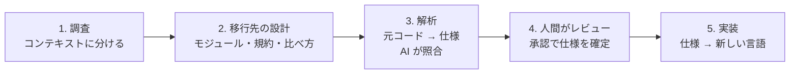

# spec-relay

[OpenSpec](https://github.com/Fission-AI/OpenSpec) を使って、コードベースを別のプログラミング言語へ移すための GitHub Copilot 用キットです。元のコードから仕様を起こし、人間がその仕様をレビューし、レビュー済みの仕様をもとに新しい言語で実装します。

> **状態：0.5.0**。工程の骨組み・OpenSpec スキーマ・導入スクリプト・テストまでです。実アカウントでの通し確認はまだ行っていません。

## 流れ



| 工程 | やること | OpenSpec 上の形 |
|---|---|---|
| 1. 調査 | コード全体を読み、DDD の境界付けられたコンテキストと capability に分ける。人がレビュー | `survey` change（スキーマ `spec-relay-survey`） |
| 2. 移行先の設計 | モジュール構成（既定は Spring Modulith 型）、共通の規約、コンテキストごとの比べ方を決める。人がレビュー | `target-design` change（スキーマ `spec-relay-target`） |
| 3. 解析 | 元のコードを読み、今の動作を言語に依存しない仕様と画面の記録にする。別の AI が元コードと照合 | `extract-<capability>` change（スキーマ `spec-relay-extract`） |
| 4. レビュー | 人が HTML で見て、要件・画面・疑問点を確認し、承認したら archive | extract change の apply と archive |
| 5. 実装 | 確定した仕様をモジュールごとに実装し、選んだ方式で元と比べる。細かいロジックは元コードを参照 | `port-<capability>` change（スキーマ `spec-relay-port`） |
| 修正 | 仕様が元コードを読み違えていたときに、差分だけ直して再レビュー | `amend-<capability>` change（スキーマ `spec-relay-amend`） |

工程 1・2 はプロジェクトで1回、工程 3〜5 は機能のまとまり（capability）ごとに回すので、レビュー済みのものから順に実装を始められます。詳しくは [docs/WORKFLOW.md](docs/WORKFLOW.md) を参照してください。

## 対応アプリ

GitHub Copilot CLI・VS Code・GitHub Copilot app を想定しています。入口はどれも **`spec-relay-orchestrator`** エージェント1つで、チャットで頼むと AI がコマンドを実行して報告します。

- **VS Code** は Copilot ハーネス（1.143 から既定）で使ってください。Local ハーネスは 1.146（2026-11-11）で非推奨になり、2027年2月に削除される予定のため、対象にしていません。
- **Copilot CLI** は 1.0.109 以降を勧めます。並列に動くサブエージェントの許可確認の修正が 1.0.106 から 1.0.109 に入っています（確認が重複して残る、長いセッションでサブエージェントの操作が効かなくなる、など）。`copilot --version` で確かめられます。
- **ファイル編集の許可**：解析担当・照合担当・実装担当は自分のファイルを書きます。最初の並列作業の前にファイル編集をセッション中は許可しておくと、サブエージェントが許可待ちで止まりません。許可はできるだけ `openspec/` と移行先のフォルダーに絞ってください。

  | アプリ | 許可の選び方（2026-11-11 時点の公式情報） |
  |---|---|
  | VS Code | 権限は Manual・Assisted・Allow all。Manual では編集の許可をファイル単位かフォルダー単位で出せますが、フォルダー単位は Git リポジトリ全体が対象で、元コードも含みます。`chat.tools.edits.autoApprove` 設定で、ファイルパターンごとに承認の要否を決められます（例：`{"**/*": false, "openspec/**": true, "<移行先のフォルダー>/**": true}`） |
  | Copilot app | Ask every time・Assisted・Approve all |
  | Copilot CLI | `/permissions` で、毎回確認・assisted・allow-all を切り替えます。「このリポジトリでは今後確認しない」は Git リポジトリ全体が対象です。並列のファイル操作でこれを選ぶと、同時に出ていた確認もまとめて承認されます（1.0.109 から）。並列に起動した呼び出しのどれか1つを拒否すると、一緒に起動したものも取り消されます |

  リポジトリ全体を許可した場合でも、オーケストレーターが波の前後に `gate.mjs guard` で元コード・review.md・ベースライン仕様などのハッシュを比べ、割り当て外の変更があれば止まって知らせます。

## 必要なもの

Windows を主な実行環境として扱います（macOS・Linux でも動きます）。Windows での入れ方と注意点は [docs/WINDOWS.md](docs/WINDOWS.md) にまとめています。

| 必要なもの | Windows での入れ方の例 |
|---|---|
| Node.js 22.12 以上（OpenSpec の要件） | `winget install OpenJS.NodeJS.LTS` |
| [OpenSpec CLI](https://github.com/Fission-AI/OpenSpec) 1.17.0（テストはこの版で実行） | `npm install -g @fission-ai/openspec@1.17.0` |
| GitHub Copilot（CLI・VS Code・Copilot app のいずれか）。CLI は 1.0.109 以降、VS Code は 1.143 以降 | CLI は `npm install -g @github/copilot` |

## 導入

### プラグインとして入れる

Copilot CLI の場合（PowerShell でもそのまま実行できます）：

```powershell
copilot plugin marketplace add umauma00/spec-relay
copilot plugin install spec-relay@spec-relay-marketplace
```

VS Code と Copilot app でも、同じ登録元（`umauma00/spec-relay`）をマーケットプレイスとして追加して `spec-relay` を入れます。

### 最初に環境を確かめる

移行の途中で環境が原因で止まらないよう、オーケストレーターは毎回のセッションの最初に `scripts/doctor.mjs` で環境を確かめ、足りないものと、それぞれ何をすればよいかを知らせます。`FAIL` があるうちは調査を始めません。手で実行することもできます（何も書き換えません）。

```powershell
node "C:\path\to\spec-relay\scripts\doctor.mjs" --target . --client cli
```

`--client` は使うアプリに合わせて `cli`・`vscode`・`app` のどれかにします。確かめること：

| 対象 | 確かめること | 足りないとき |
|---|---|---|
| Node.js | 22.12 以上（古い Node.js でも、このメッセージは出ます） | FAIL |
| キット | スキーマ・スクリプト・エージェントがそろっているか | FAIL |
| OpenSpec CLI | 起動できて、版が 1.17.0 か（古いと FAIL、新しいと WARN）。入れる前に開いたターミナルで PATH にないとき（WARN） | FAIL |
| OpenSpec の利用統計 | 送信が止まっているか（止め方を案内。キットは設定を変えません） | INFO |
| PowerShell | 実行ポリシーで `openspec` が止まるか（`openspec.cmd` を案内） | INFO |
| Copilot のアプリ | Copilot CLI 1.0.109 以上、VS Code 1.143 以上 | WARN |
| git | git があるか、リポジトリの一番上か、「所有者が違う」で拒否されていないか、長いパス | WARN |
| フォルダー | 書き込めるか（「コントロールされたフォルダー アクセス」など）、OneDrive などの同期フォルダーやネットワーク上のフォルダーでないか | FAIL・WARN |
| 導入済みのリポジトリ | スキーマがキットの版と同じか、`openspec update` で apply・archive・sync が戻っていないか、元コードのフォルダーがあるか、移行先の言語のビルド道具（JDK・Python・.NET SDK など） | FAIL・WARN |
| サブエージェント | 導入のあとに1回、解析・照合・実装担当を同時に起動して、それぞれファイルを1つ書かせる試運転（`--trial`・`--trial-check`。実装担当は移行先のフォルダーに書き、`node --version` も実行）。エージェントが見つかるか、モデルが使えるか、書き込みとコマンド実行の許可が出るかを最初に確かめます | FAIL |

終了コードは、0 なら始められる（WARN が残ることはある）、1 なら FAIL を直してからです。試運転の結果は PC とアプリごとに `openspec/spec-relay/local/trial.json`（git では無視）に残り、モデルの設定を変えたときや、別の PC・アプリで使い始めたときは、もう一度試運転を求めます。

### 移行対象のリポジトリを準備する

移行したいリポジトリを開いて `spec-relay-orchestrator` を選び、「Java から TypeScript への移行を始めて」のように頼みます。AI が言語とフォルダーを聞いたうえで、次の導入スクリプトを実行します（手で実行してもかまいません）。

```powershell
node "C:\path\to\spec-relay\scripts\setup.mjs" --target . --source-language "Java" --target-language "TypeScript" --source-root "src" --target-root "ts" --language ja
```

- これは確認だけで、何も書き換えません。内容を見てから、同じコマンドの最後に `--apply` を付けて反映します。
- PowerShell・コマンドプロンプト・bash のどれでも同じ1行で動きます。キットのパスは `"` で囲んでください（プラグインとして入れた場合は、ホームフォルダーの `.copilot\installed-plugins\` の下にあります）。
- 並列化の設定（あとから変えるときは `openspec/config.yaml` の値を書き換えます）：

  | オプション | 中身 | 既定 |
  |---|---|---|
  | `--parallel 16` | 同時に動かすサブエージェントの数（1〜32） | 4 |
  | `--ahead 2` | レビューより先に解析しておく機能の数（1〜10） | 2 |
  | `--subagent-model "<モデル>"` | サブエージェント（解析・照合・実装担当）のモデル | `session`（オーケストレーターと同じ） |
  | `--checker-model "<モデル>"` など | 役割ごとのモデル（`--analyst-model`・`--implementer-model` も） | `--subagent-model` と同じ |

  同時実行数の上限は Copilot の契約で違います。Copilot CLI のリファレンス（2026-11-10 時点）では Free 2、Pro 4、Max 8、Business 16、Enterprise と従量課金 32 で、孫のサブエージェントも含めたセッション全体の数です。従量課金でない契約ではこの数を上げられません。VS Code と Copilot app の上限は公式に書かれていません。モデルは、オーケストレーターがサブエージェントに頼むときに指定します。セッションのモデルが Auto のときや、ホストが指定を受け付けないときは、オーケストレーターと同じモデルで動きます。

導入で置かれるもの：

| 場所 | 中身 |
|---|---|
| `openspec/schemas/spec-relay-*/` | 各工程のスキーマとテンプレート（survey・target・extract・amend・port） |
| `openspec/config.yaml` | 移行元・移行先の言語とフォルダー（全成果物の生成に使われる） |
| `.github/skills/openspec-*`、`.github/prompts/opsx-*` | `openspec init --tools github-copilot` が置く OpenSpec 標準のスキルとコマンド（propose・explore・update） |

- 内容の違う既存ファイルがあると、上書きせずに衝突を表示して止まります。`openspec init` が置き換え・削除・編集するファイル（既存の `opsx-*`・`openspec-*`、`openspec/AGENTS.md` など）が既にある場合も、同じく止まります。
- OpenSpec 標準の apply・archive（bulk-archive を含む）・sync（スキルとコマンド）は、レビューの確認を通らずにチェックや archive ができてしまうため、導入スクリプトが中身を「`spec-relay-orchestrator` を使ってください」という案内に置き換えて無効にします。ファイル自体を消さないのは、消すと後の `openspec update` が利用者の OpenSpec 全体の設定（Windows では `%APPDATA%\openspec`）から、ほかのプロジェクトも含めてこれらのワークフローを外してしまうためです。`openspec update` で元の中身に戻ったときは、もう一度導入スクリプトを実行してください。

## 守っていること

- **元のコードは書き換えない。** すべてのエージェントにとって読み取り専用です。
- **仕様の確定は人が決める。** AI は人が認めた項目だけをチェックし、明示的な承認なしに archive しません。レビューはチャットで1項目ずつでも、ファイルや PR でまとめてでもかまいません。archive の前に `scripts/gate.mjs review` で、すべての要件・画面・質問・コンテキストがチェックリストにあり、チェック済みで、質問への判断とレビュー担当の名前が書かれ、AI の照合が解決し、元ファイルがすべて調査に含まれていることを確かめます（`openspec archive --yes` 自体はこれを確かめません）。
- **実装の前後も確かめる。** port は、調査・移行先の設計・ベースライン仕様がそろい、修正中でないことを `gate.mjs port-ready` で確かめてから始めます。すべてのタスクの完了と、着手時から仕様が変わっていないこと（ハッシュ）を `gate.mjs port-done` で確かめてから archive します。
- **仕様の修正は読み違いだけ。** 動きそのものを変えたいときは、移行後の別作業にします。
- **正は markdown、見るのは HTML。** レビューでは `scripts/render.mjs` が成果物を1枚の HTML にします（要件ごとのカード、シナリオ、元コードの該当行、質問と判断、進み具合）。デザインはスクリプトに固定しているので、どのモデルでも同じ見た目になります。判断は markdown（review.md）に記録します。
- **仕様が契約。** 実装中に元コードと仕様が食い違ったら、AI はどちらかを選ばず人に聞きます。
- **並列で進めても、レビューは1本。** 解析・照合・実装はサブエージェントが同時に進め、人のレビューは1つずつです。先に解析しておくのは `--ahead` 件までにして、レビュー待ちを溜めません。サブエージェントは割り当てられたファイルだけを書き、オーケストレーターには短い報告だけを返すので、長い移行でもオーケストレーターの文脈が埋まりにくくなっています（[詳しく](docs/WORKFLOW.md#並列での進め方)）。
- **工程を飛ばさない。** 次の工程に進む前の確認は `gate.mjs` がします（解析の承認には調査の archive と、調査の一覧にある capability が必要。実装の開始には調査・移行先の設計・確定した仕様が必要）。「飛ばして」と頼まれても、AI は確認を外さず、その工程が守っているものと最短の進め方を説明します。gate を実行するのはオーケストレーターなので、フックが無効の間は AI が指示を守ることが前提です。フックを有効にすると、gate を通らない archive と、元コード・確定仕様・設定への書き込みを Copilot が実行前に拒否します（[下の「止まったとき」](#止まったとき)）。
- **進捗は Copilot の TODO に出す。** `scripts/status.mjs` が `openspec/` のファイルから進捗を計算し、オーケストレーターが「全体1行 + いまの機能の工程 + 並行して動いている機能」を TODO リストに出します。報告の先頭にも同じ一覧を出します。TODO のチェックは承認になりません（[詳しく](docs/WORKFLOW.md#進捗の表示copilot-の-todo)）。

## 止まったとき

AI が止まったときは、報告の最初に「止まった理由」「あなたにお願いすること」「AI がやること」の3つを書きます。`gate.mjs` は、人にしかできないこと（`next.person`、利用者の言語の文）と、AI が直すこと（`next.agent`）を分けて出します。

| 表示・報告 | 意味 | あなたがすること |
|---|---|---|
| TODO の【レビュー待ち 3/8】 | レビューの途中 | 残りの項目を見て、チャットで承認するか review.md でチェックする |
| 「未承認の項目が N 件」 | gate review が未チェックの項目を見つけた | 同上 |
| 「承認者の名前がありません」 | review.md の `Reviewer:` が空 | 記録する名前を伝える |
| 「判断がまだの質問」 | questions.md の質問に判断がない | 新しいシステムでどうするかを決める |
| 「〜のレビューがまだ終わっていません」 | 実装の前に、その仕様のレビューが必要 | そのレビューを終える |
| 【全項目チェック済み・gate 未通過】 | 成果物の不備（照合の残り、項目の漏れなど）か、調査がまだ archive されていない | 不備なら何もしなくてよい（AI が直して確かめ直す）。調査が未完了なら、AI が用意する調査のレビューをする |
| 「archive してよいか」 | gate を通った | 確定してよければ「はい」と答える |
| 「割り当て外のファイルが変わりました」 | サブエージェントが担当外を書いた | 元に戻すか、受け入れるかを決める |
| `spec-relay:` で始まる拒否 | フックが実行前に止めた | 理由のとおり。設定や元コードを変えたいときは自分で変える |
| 導入スクリプトの「衝突」 | 既存ファイルと中身が違う | どちらを残すかを決める（何も変更されていない） |
| コマンドがない・アクセス拒否など | 環境の問題 | AI が環境チェック（`scripts/doctor.mjs`）の直し方を伝えるので、そのとおりにする（[docs/WINDOWS.md](docs/WINDOWS.md) も参照） |

同じ確認で2回直しても通らないときは、AI は止まって残りの問題を見せ、進め方を聞きます。

### フック（試験中・既定は無効）

プラグインには Copilot の preToolUse フック（`com.github.copilot/hooks/hooks.json`）が入っています。形式とツール名は Copilot CLI の公式資料に合わせています。VS Code（Copilot ハーネス）と Copilot app は同じ実行環境なので同じように動くはずですが、実機ではまだ確かめていません。有効にした移行対象のリポジトリでだけ、次を実行前に拒否します。

- gate を通らない `openspec archive`（`openspec`・`openspec.cmd`・`npx @fission-ai/openspec` などの書き方と、`cd` してからの実行を含む）、change 名のない archive、変数で名前を渡す archive、サブエージェントからの archive
- 元コード（元のフォルダーが `.` のときは `openspec/` と移行先のフォルダー以外のすべて）、`openspec/specs/`、`openspec/changes/archive/`、`openspec/schemas/`、`openspec/config.yaml`、キット自体への書き込み
- サブエージェントによる review.md・questions.md・計画の書き込み

有効にするには、`openspec/config.yaml` の context に次の1行を足すか、`on` に変えます（導入時なら `--hooks on`。導入済みのリポジトリでは `--hooks` は反映されないので、この行を自分で直します）。フックが有効な間、AI の編集ツールは config.yaml を書けず、この行や config.yaml を書き換えるシェルコマンドも拒否されます（無効の間も、AI には変えないように指示しています）。

```yaml
  Hook enforcement (on or off; on denies archives that fail the gate and agent writes to protected files): on
```

- 実機（特に Windows）での確認がまだなので、既定は無効です。node が見つからないなどでフックが動かないときは、拒否せずに通常の許可確認へ進みます（Copilot は終了コードが 0 以外だとそのツールの実行を拒否するので、壊れたフックですべての操作が止まらないよう、必ず 0 を返します）。
- シェルコマンドでの書き込み（`Set-Content` など）は、config.yaml へのもの以外は読み取りません。これはオーケストレーターの `gate.mjs guard` が後から見つけます。
- フックはプラグインを入れたすべてのリポジトリで、シェルとファイル編集の前に1回ずつ起動します（node の起動1回分。spec-relay のリポジトリでなければすぐ終わります）。ホストがプラグインの場所（`PLUGIN_ROOT`）を渡さないときは何もしません。
- チャットでの承認は AI が review.md に書くので、「AI が勝手にチェックを付ける」ことはフックでは区別できません。承認は今も、チャットでのあなたの言葉と gate の合格の両方です。

## 0.4.0 から更新するとき

- extract と amend の承認（`gate.mjs review`）に、調査の archive、調査の一覧（または計画の `## Capabilities`）にある capability、その capability の change 名が必要になりました。進行中の change が通らなくなったら、表示に従って計画に capability を足すか、change の名前を合わせます。
- フックを使うときは、`openspec/config.yaml` に「止まったとき」の1行を足します（なければ無効）。スキーマは変わっていないので、導入スクリプトのやり直しは不要です。

## 0.3.0 から更新するとき

0.4.0 で環境チェック（`scripts/doctor.mjs`）が加わりました。スキーマと設定は変わっていないので、導入し直す必要はありません。次のセッションの最初に、オーケストレーターが環境を確かめ、サブエージェントの試運転を1回行います。

## 0.2.0 から更新するとき

0.3.0 で、サブエージェントを並列に動かす手順に変わり、survey・extract・amend のスキーマの説明文が変わりました。導入スクリプトをもう一度実行するとスキーマの違いを表示して止まるので、`openspec/schemas/spec-relay-*` を削除してから実行し直してください。`openspec/config.yaml` はそのまま残るので、次の2か所を手で直します。

- context に並列化の5行を足す（ない場合は既定の 4・2・`session` で動きます）。

  ```yaml
    Parallel subagents (at once, whole session): 16
    Analyses ahead of review: 2
    Analyst model: session
    Checker model: session
    Implementer model: session
  ```

- rules の `raise doubts in questions.md.` を `raise doubts as questions for questions.md.` に変える（questions.md はオーケストレーターだけが書くため）。

## 0.1.0 から更新するとき

0.2.0 で、解析の前に「調査」と「移行先の設計」の工程が加わりました。導入スクリプトをもう一度実行すると、スキーマが新しい版と違うと表示して止まるので、`openspec/schemas/spec-relay-*` を削除してから実行し直してください。進行中の extract change は、新しく加わった screens.md と crosscheck.md を書き足したうえで、調査を archive すると gate を通ります（0.5.0 から、extract の承認には調査が必要です）。先にオーケストレーターに調査を頼み、その一覧に進行中の capability を入れてください。確定済みの仕様（ベースライン）はそのまま残り、`gate.mjs port-ready` はこの2つが終わるまで実装の開始を止めます。

## リポジトリの構成

```text
plugin.json                    プラグイン定義（Agent Plugins 1.0）
.github/plugin/marketplace.json マーケットプレイス定義
com.github.copilot/agents/     オーケストレーター・解析担当・照合担当・実装担当
com.github.copilot/hooks/      実行前に archive と書き込みを確かめるフック（既定は無効）
skills/spec-relay/SKILL.md     オーケストレーターの手順
skills/spec-relay-view/        markdown を HTML にして見せるスキル
openspec-schemas/              移行用の OpenSpec スキーマ
templates/openspec-config.yaml 移行対象に置く OpenSpec 設定のひな形
scripts/setup.mjs              導入スクリプト（外部パッケージなし）
scripts/gate.mjs               承認・実装の前に使う機械的な確認（止まったときの次の一手も出す）
scripts/hook.mjs               フックの本体（gate を通らない archive と保護されたファイルへの書き込みを拒否）
scripts/status.mjs             進捗の計算（TODO リスト・チャット用）と、次に並列で始めてよい作業
scripts/merge.mjs              サブエージェントが分担して書いた表を1つの成果物にまとめる
scripts/render.mjs             成果物の markdown をレビュー用の HTML にする（デザイン固定）
scripts/doctor.mjs             最初の環境チェックとサブエージェントの試運転
scripts/openspec.mjs           OpenSpec CLI の起動（Windows でシェルを通さない）
tests/                         node:test のテスト（OpenSpec があれば通しの確認も）
docs/WORKFLOW.md               流れと設計の説明、今後の課題
docs/WINDOWS.md                Windows での準備と注意点
```

## 開発

```powershell
npm install -g @fission-ai/openspec@1.17.0
npm test
```

OpenSpec がない端末では、OpenSpec を実際に動かす通しのテストだけ skip と表示されます（CI では skip せず失敗にします）。テストは一時フォルダーの設定を使うので、手元の OpenSpec の設定は変わりません。CI は Windows と Ubuntu の Node.js 22・24 で実行しています。

ライセンスはまだ決めていません（LICENSE は未配置）。

構成と考え方は [code-migration-kit-with-github-copilot](https://github.com/umauma00/code-migration-kit-with-github-copilot) を参考にしています。違いは [docs/WORKFLOW.md](docs/WORKFLOW.md#先行例code-migration-kit-with-github-copilotから引き継いだこと) にあります。
