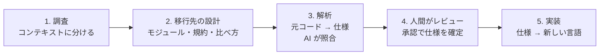

# spec-relay

[OpenSpec](https://github.com/Fission-AI/OpenSpec) を使って、コードベースを別のプログラミング言語へ移すための GitHub Copilot 用キットです。元のコードから仕様を起こし、人間がその仕様をレビューし、レビュー済みの仕様をもとに新しい言語で実装します。

> **状態：0.2.0**。工程の骨組み・OpenSpec スキーマ・導入スクリプト・テストまでです。実アカウントでの通し確認はまだ行っていません。

## 流れ



| 工程 | やること | OpenSpec 上の形 |
|---|---|---|
| 1. 調査 | コード全体を読み、DDD の境界付けられたコンテキストと capability に分ける。人がレビュー | `survey` change（スキーマ `spec-relay-survey`） |
| 2. 移行先の設計 | モジュール構成（既定は Spring Modulith 型）、共通の規約、コンテキストごとの比べ方を決める。人がレビュー | `target-design` change（スキーマ `spec-relay-target`） |
| 3. 解析 | 元のコードを読み、今の動作を言語に依存しない仕様と画面の記録にする。別の AI が元コードと照合 | `extract-<capability>` change（スキーマ `spec-relay-extract`） |
| 4. レビュー | 人が HTML で見て、要件・画面・疑問点を確認し、承認したら archive | extract change の apply と archive |
| 5. 実装 | 確定した仕様をモジュールごとに実装し、選んだ方式で元と比べる。細かいロジックは元コードを参照 | `port-<capability>` change（スキーマ `spec-relay-port`） |
| 修正 | 仕様が元コードを読み違えていたときに、差分だけ直して再レビュー | `amend-<capability>` change（スキーマ `spec-relay-amend`） |

工程 1・2 はプロジェクトで1回、工程 3〜5 は機能のまとまり（capability）ごとに回すので、レビュー済みのものから順に実装を始められます。詳しくは [docs/WORKFLOW.md](docs/WORKFLOW.md) を参照してください。

## 対応アプリ

GitHub Copilot CLI・VS Code・GitHub Copilot app を想定しています。入口はどれも **`spec-relay-orchestrator`** エージェント1つで、チャットで頼むと AI がコマンドを実行して報告します。

## 必要なもの

Windows を主な実行環境として扱います（macOS・Linux でも動きます）。Windows での入れ方と注意点は [docs/WINDOWS.md](docs/WINDOWS.md) にまとめています。

| 必要なもの | Windows での入れ方の例 |
|---|---|
| Node.js 22.12 以上（OpenSpec の要件） | `winget install OpenJS.NodeJS.LTS` |
| [OpenSpec CLI](https://github.com/Fission-AI/OpenSpec) 1.17.0（テストはこの版で実行） | `npm install -g @fission-ai/openspec@1.17.0` |
| GitHub Copilot（CLI・VS Code・Copilot app のいずれか） | |

## 導入

### プラグインとして入れる

Copilot CLI の場合（PowerShell でもそのまま実行できます）：

```powershell
copilot plugin marketplace add umauma00/spec-relay
copilot plugin install spec-relay@spec-relay-marketplace
```

VS Code と Copilot app でも、同じ登録元（`umauma00/spec-relay`）をマーケットプレイスとして追加して `spec-relay` を入れます。

### 移行対象のリポジトリを準備する

移行したいリポジトリを開いて `spec-relay-orchestrator` を選び、「Java から TypeScript への移行を始めて」のように頼みます。AI が言語とフォルダーを聞いたうえで、次の導入スクリプトを実行します（手で実行してもかまいません）。

```powershell
node "C:\path\to\spec-relay\scripts\setup.mjs" --target . --source-language "Java" --target-language "TypeScript" --source-root "src" --target-root "ts" --language ja
```

- これは確認だけで、何も書き換えません。内容を見てから、同じコマンドの最後に `--apply` を付けて反映します。
- PowerShell・コマンドプロンプト・bash のどれでも同じ1行で動きます。キットのパスは `"` で囲んでください（プラグインとして入れた場合は、ホームフォルダーの `.copilot\installed-plugins\` の下にあります）。

導入で置かれるもの：

| 場所 | 中身 |
|---|---|
| `openspec/schemas/spec-relay-*/` | 各工程のスキーマとテンプレート（survey・target・extract・amend・port） |
| `openspec/config.yaml` | 移行元・移行先の言語とフォルダー（全成果物の生成に使われる） |
| `.github/skills/openspec-*`、`.github/prompts/opsx-*` | `openspec init --tools github-copilot` が置く OpenSpec 標準のスキルとコマンド（propose・explore・update） |

- 内容の違う既存ファイルがあると、上書きせずに衝突を表示して止まります。`openspec init` が置き換え・削除・編集するファイル（既存の `opsx-*`・`openspec-*`、`openspec/AGENTS.md` など）が既にある場合も、同じく止まります。
- OpenSpec 標準の apply・archive（bulk-archive を含む）・sync（スキルとコマンド）は、レビューの確認を通らずにチェックや archive ができてしまうため、導入スクリプトが中身を「`spec-relay-orchestrator` を使ってください」という案内に置き換えて無効にします。ファイル自体を消さないのは、消すと後の `openspec update` が利用者の OpenSpec 全体の設定（Windows では `%APPDATA%\openspec`）から、ほかのプロジェクトも含めてこれらのワークフローを外してしまうためです。`openspec update` で元の中身に戻ったときは、もう一度導入スクリプトを実行してください。

## 守っていること

- **元のコードは書き換えない。** すべてのエージェントにとって読み取り専用です。
- **仕様の確定は人が決める。** AI は人が認めた項目だけをチェックし、明示的な承認なしに archive しません。レビューはチャットで1項目ずつでも、ファイルや PR でまとめてでもかまいません。archive の前に `scripts/gate.mjs review` で、すべての要件・画面・質問・コンテキストがチェックリストにあり、チェック済みで、質問への判断とレビュー担当の名前が書かれ、AI の照合が解決し、元ファイルがすべて調査に含まれていることを確かめます（`openspec archive --yes` 自体はこれを確かめません）。
- **実装の前後も確かめる。** port は、調査・移行先の設計・ベースライン仕様がそろい、修正中でないことを `gate.mjs port-ready` で確かめてから始めます。すべてのタスクの完了と、着手時から仕様が変わっていないこと（ハッシュ）を `gate.mjs port-done` で確かめてから archive します。
- **仕様の修正は読み違いだけ。** 動きそのものを変えたいときは、移行後の別作業にします。
- **正は markdown、見るのは HTML。** レビューでは `scripts/render.mjs` が成果物を1枚の HTML にします（要件ごとのカード、シナリオ、元コードの該当行、質問と判断、進み具合）。デザインはスクリプトに固定しているので、どのモデルでも同じ見た目になります。判断は markdown（review.md）に記録します。
- **仕様が契約。** 実装中に元コードと仕様が食い違ったら、AI はどちらかを選ばず人に聞きます。
- **進捗は Copilot の TODO に出す。** `scripts/status.mjs` が `openspec/` のファイルから進捗を計算し、オーケストレーターが「全体1行 + いまの機能の工程」を TODO リストに出します。報告の先頭にも同じ一覧を出します。TODO のチェックは承認になりません（[詳しく](docs/WORKFLOW.md#進捗の表示copilot-の-todo)）。

## 0.1.0 から更新するとき

0.2.0 で、解析の前に「調査」と「移行先の設計」の工程が加わりました。導入スクリプトをもう一度実行すると、スキーマが新しい版と違うと表示して止まるので、`openspec/schemas/spec-relay-*` を削除してから実行し直してください。進行中の extract change は、新しく加わった screens.md と crosscheck.md を書き足すと gate を通ります。そのあと、オーケストレーターに調査と移行先の設計を頼んでください。確定済みの仕様（ベースライン）はそのまま残り、`gate.mjs port-ready` はこの2つが終わるまで実装の開始を止めます。

## リポジトリの構成

```text
plugin.json                    プラグイン定義（Agent Plugins 1.0）
.github/plugin/marketplace.json マーケットプレイス定義
com.github.copilot/agents/     オーケストレーター・解析担当・照合担当・実装担当
skills/spec-relay/SKILL.md     オーケストレーターの手順
skills/spec-relay-view/        markdown を HTML にして見せるスキル
openspec-schemas/              移行用の OpenSpec スキーマ
templates/openspec-config.yaml 移行対象に置く OpenSpec 設定のひな形
scripts/setup.mjs              導入スクリプト（外部パッケージなし）
scripts/gate.mjs               承認・実装の前に使う機械的な確認
scripts/status.mjs             進捗の計算（TODO リスト・チャット用）
scripts/render.mjs             成果物の markdown をレビュー用の HTML にする（デザイン固定）
scripts/openspec.mjs           OpenSpec CLI の起動（Windows でシェルを通さない）
tests/                         node:test のテスト（OpenSpec があれば通しの確認も）
docs/WORKFLOW.md               流れと設計の説明、今後の課題
docs/WINDOWS.md                Windows での準備と注意点
```

## 開発

```powershell
npm install -g @fission-ai/openspec@1.17.0
npm test
```

OpenSpec がない端末では、OpenSpec を実際に動かす通しのテストだけ skip と表示されます（CI では skip せず失敗にします）。テストは一時フォルダーの設定を使うので、手元の OpenSpec の設定は変わりません。CI は Windows と Ubuntu の Node.js 22・24 で実行しています。

ライセンスはまだ決めていません（LICENSE は未配置）。

構成と考え方は [code-migration-kit-with-github-copilot](https://github.com/umauma00/code-migration-kit-with-github-copilot) を参考にしています。違いは [docs/WORKFLOW.md](docs/WORKFLOW.md#先行例code-migration-kit-with-github-copilotから引き継いだこと) にあります。
