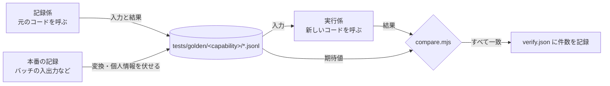
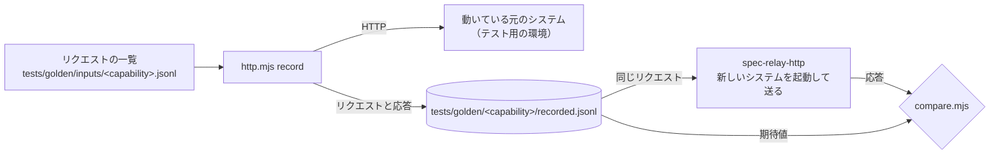

# 元のプログラムとの比較（比べ方 B1）

比べ方 A（仕様のシナリオから作ったテスト）は、AI が元コードを読んで書いた仕様と期待値で確かめます。元のプログラムは動かしていないので、同じ動きであることは「推定」です。B1 は、**元のプログラムが実際に返した結果**を記録し、同じ入力を新しいコードに通して、1件ずつ比べます。



| 役 | 書く人 | 言語 | 中身 |
|---|---|---|---|
| 記録係（recorder） | 実装担当（port の B1 タスク） | 移行元（C#・PHP など） | 入力の一覧を元のコードに通し、入力と結果をケースとして書く |
| 実行係（driver） | 実装担当（port の B1 タスク） | 移行先（TypeScript・Python・Java など） | 標準入力のケースを新しいコードに通し、結果を標準出力に書く |
| 比較 | キット（`scripts/compare.mjs`） | Node.js | 期待値と結果を比べ、違う箇所を示す |

## いつ使えるか

| 元のプログラム | B1 のケースの作り方 |
|---|---|
| ソースからビルドして手元で動かせる | 記録係が元のロジックを直接呼ぶ（画面やサインインは通さない） |
| 動かせるが、ロジックを単独では呼べない（PHP のページに直接書かれた処理、WebForms のコードビハインドなど） | 動いている元のシステムに HTTP でリクエストを送って記録する（下の「[直接呼べないロジック](#直接呼べないロジックhttp-越しの記録)」） |
| 手元では動かないが、本番の実行の記録がある | バッチの入力と出力のファイル、帳票のデータ、プログラムがデータベースに書き込んだレコードなどを変換してケースにする |
| どちらもない | B1 は使えない。A だけになり、完了時に「推定」と知らせる |

## ケースの形式

`<移行先>/tests/golden/<capability の / を - にしたもの>/` の下の `*.jsonl` です（サブフォルダーの中も読みます）。1行に1ケースです。

```json
{"id": "invoice-month-end-01", "input": {"customer": "C001", "date": "2026-01-31"}, "expected": {"total": 10800, "tax": 800}}
{"id": "invoice-negative", "input": {"customer": "C001", "amount": -1}, "expected": {"error": "金額が不正です"}}
```

- `id` は空でない文字列で、フォルダー全体で重複できません。`input` と `expected` は任意の JSON です。ほかのキー（`note` など）は人のためのもので、比較では読みません。
- エラーも結果です。元のプログラムが例外やメッセージを返すなら、それを `expected` に書き、実行係も同じ形で返します。
- 文字コードは UTF-8 です（先頭の BOM は無視し、CRLF の改行も読めます）。UTF-16 や Shift_JIS のファイルは失敗として報告します。Windows PowerShell 5.1 の `>` は UTF-16 で書くので、ケースは記録係が UTF-8 で直接書きます。
- 桁の多い整数（16桁を超える ID など）や、桁を正確に保ちたい小数（金額など）は、JSON の数値にすると桁が落ちることがあるので、文字列で書きます。記録係と実行係の両方で同じ形にします。
- 記録係の入力の一覧（`inputs.jsonl`）や、比較の途中のファイルは、ケースのフォルダーの外に置きます（フォルダーの中の `*.jsonl` はすべてケースとして読みます）。
- ケースは移行先のフォルダーの中に置きます。`gate.mjs port-done` はそれ以外の場所を受け付けません。verify はケースと `rules.json` のハッシュ（中身から計算した値）を記録し、port-done がもう一度計算して比べます。verify のあとにケースや規則を書き換えると、コードを書き換えたときと同じく port-done が止まります。

**期待値は元のプログラムからだけ取ります。** 新しいコードの結果を写したり、手で直したりすると、比べる意味がなくなります。記録が間違っていると思ったら、記録係でもう一度記録します。照合担当（port check）は、記録係が元のコードを呼んでいるか、いくつかの期待値が元コードをたどった値と合うかを確かめます。

## 比べ方の規則（rules.json）

ケースのフォルダーに `rules.json` を置くと、比べ方をゆるめられます。**どれも差を見逃す方向に働く**ので、port の design.md の Decisions に、規則ごとの理由を書きます（照合担当が確かめます）。

```json
{
  "ignore": ["$.createdAt", "$.lines[*].id"],
  "tolerance": 0.005,
  "numbersAsText": false,
  "trim": false,
  "unordered": ["$.lines"],
  "missingIsNull": false
}
```

| 規則 | 意味 | よくある理由 |
|---|---|---|
| `ignore` | このパスの値を比べない | 実行時刻、採番した ID |
| `tolerance` | 数値がこの幅まで違ってよい | 浮動小数点の誤差（金額の丸めには使わない。丸めは同じであるべき）。規則がなくても、整数どうしは完全に一致する必要があり、小数はごくわずかな計算誤差（`0.1 + 0.2` と `0.3` など）だけを同じとみなす |
| `numbersAsText` | 片方が数値のとき、もう片方の文字列を数値として読む（`"12.50"` と `12.5` を同じとみなす。文字列どうしは文字列のまま比べる） | PHP が数値を文字列で返す |
| `trim` | 文字列の前後の空白を無視する | 固定長の CHAR 列 |
| `unordered` | この配列の順番を無視する | 元が ORDER BY のない SELECT（順番が仕様でないことを確かめてから） |
| `missingIsNull` | キーがないことと null を同じとみなす | シリアライザーの違い |

パスは `$` のあとに `.名前`、`[番号]`、`[*]`、`.*` を続けます（`$` は結果全体）。知らない規則名や書式に合わないパス、結果全体を比べなくなる `ignore`（`$` や `$.*` だけのもの）、負の数や無限大の `tolerance` は、比較の失敗として報告します。サブフォルダーの `rules.json` は読みません（読まないことを報告します）。使った規則は比較の表示と完了時の知らせに出ます。

## port の design.md の書き方

```markdown
## Verification
| Level | Covers | Command |
|---|---|---|
| A scenario tests | every scenario | |
| B1 logic comparison | 請求額の計算（記録 120 件） | `spec-relay-compare --cases tests/golden/billing-invoice --driver "node tests/golden/driver.mjs"` |
```

- コマンドは移行先のフォルダーで実行します。`spec-relay-compare` は design.md に書くための名前で、`verify.mjs` がキットの compare.mjs で実行するので、キットの場所は書きません。ターミナルに `spec-relay-compare` と打っても動きません。手で試すときは、下の「表示と終了コード」の単独での実行を使います。
- `--driver` のコマンドは1つだけです（`a; b` やパイプは前の失敗が隠れるので受け付けません）。中で引用符が要るときは、外側と別の種類を使います（`--driver 'python -m tools.replay "x y"'`）。
- 時間の上限は verify の上限（既定 60 分）です。`--timeout-minutes N` で変えられます。

完了時（`gate.mjs port-done` が通ったとき）には、「B1: 元のプログラムから記録した 120 件がすべて一致」のように件数を知らせます。

## 実行係の例

実行係は、標準入力から1行に1つ `{"id": ..., "input": ...}` を読み、新しいコードに通して、標準出力に1行に1つ `{"id": ..., "output": ...}` を書きます。ログは標準エラーに書きます（標準出力に JSON 以外の行があると失敗にします）。新しいコードの呼び出し元が使うのと同じ入口（モジュールの公開された関数やサービス）を呼び、ケースのファイルは開きません。照合担当は実行係も読んで確かめます。

TypeScript / JavaScript（Node.js）:

```js
// tests/golden/driver.mjs
import readline from 'node:readline';
import { issueInvoice } from '../../src/billing/invoice.js';

for await (const line of readline.createInterface({ input: process.stdin })) {
  if (!line.trim()) continue;
  const { id, input } = JSON.parse(line);
  let output;
  try { output = issueInvoice(input); } catch (e) { output = { error: e.message }; }
  process.stdout.write(JSON.stringify({ id, output }) + '\n');
}
```

Python:

```python
# tests/golden/driver.py  (python -m tests.golden.driver)
import json, sys
from billing.invoice import issue_invoice

for line in sys.stdin:
    if not line.strip():
        continue
    case = json.loads(line)
    try:
        output = issue_invoice(case["input"])
    except Exception as e:
        output = {"error": str(e)}
    sys.stdout.write(json.dumps({"id": case["id"], "output": output}, ensure_ascii=False) + "\n")
```

Java では、テスト用のソースに `main` を持つクラスを置き、ビルドツールのタスクで実行します。JSON は Jackson などで読み書きします。

- 標準入力と標準出力は、コードの中で UTF-8 を指定して開きます（`new BufferedReader(new InputStreamReader(System.in, StandardCharsets.UTF_8))` と `new PrintStream(new FileOutputStream(FileDescriptor.out), true, StandardCharsets.UTF_8)`）。
- Gradle の `JavaExec` は、そのままでは標準入力を渡さないので `standardInput = System.in` を書きます。Gradle 自身の表示が標準出力に混ざらないよう `gradlew -q` で実行します（例: `--driver "./gradlew -q goldenDriver"`）。

C#（.NET）では、ビルドした実行ファイルか DLL を直接実行します（`--driver "dotnet tests/GoldenDriver/bin/Release/net8.0/GoldenDriver.dll"`）。`dotnet run` はビルドの表示を標準出力に書くことがあるので使いません。`Console.InputEncoding` と `Console.OutputEncoding` を `new UTF8Encoding(false)` にします。

npm のスクリプトで実行するときは `npm --silent run <名前>` にします（npm が標準出力に書く見出しの行で失敗するため）。

Windows の Python は `python -X utf8` で実行し、標準入出力を UTF-8 にします。

## 記録係の例

入力の一覧（`inputs.jsonl`、1行に `{"id": ..., "input": ...}`）を元のコードに通し、ケースを書きます。入力は、仕様のシナリオすべてと、conventions.md の Language mapping にある境界値（丸め、桁あふれ、null と空文字、日付と時差、並び順）から作ります。

C#（.NET Framework の古いアセンブリを参照するコンソール。古い C# 7.3 でも動く書き方）:

```csharp
// tests/golden/recorder/Program.cs  (旧アセンブリ Billing.dll を参照)
using System; using System.Globalization; using System.IO; using System.Text; using Newtonsoft.Json; using Newtonsoft.Json.Linq;

class Program {
  static void Main(string[] args) {
    var calc = new Billing.InvoiceCalculator();
    // 日付の文字列を DateTime に読み替えさせない（入力をそのまま書き戻すため）
    var settings = new JsonSerializerSettings { DateParseHandling = DateParseHandling.None };
    using (var output = new StreamWriter(args[1], false, new UTF8Encoding(false))) {
      foreach (var line in File.ReadLines(args[0], Encoding.UTF8)) {
        if (string.IsNullOrWhiteSpace(line)) continue;
        var c = JsonConvert.DeserializeObject<JObject>(line, settings);
        object expected;
        try { expected = calc.Issue((string)c["input"]["customer"], DateTime.Parse((string)c["input"]["date"], CultureInfo.InvariantCulture)); }
        catch (Exception e) { expected = new { error = e.Message }; }
        output.WriteLine(JsonConvert.SerializeObject(new { id = (string)c["id"], input = c["input"], expected }));
      }
    }
  }
}
```

PHP（古いファイルを読み込む CLI スクリプト）:

```php
<?php
// tests/golden/recorder/record.php
// php tests/golden/recorder/record.php inputs.jsonl tests/golden/billing-invoice/recorded.jsonl
require __DIR__ . '/../../../../src/billing/invoice.php';  // 元のファイル（書き換えない）

$out = fopen($argv[2], 'w');
foreach (file($argv[1], FILE_IGNORE_NEW_LINES | FILE_SKIP_EMPTY_LINES) as $line) {
    $case = json_decode($line, true, 512, JSON_THROW_ON_ERROR);  // PHP 7.3 以降。壊れた行で止める
    try {
        $expected = issue_invoice($case['input']['customer'], $case['input']['date']);
    } catch (Throwable $e) {
        $expected = ['error' => $e->getMessage()];
    }
    fwrite($out, json_encode(['id' => $case['id'], 'input' => $case['input'], 'expected' => $expected], JSON_UNESCAPED_UNICODE | JSON_THROW_ON_ERROR) . "\n");
}
```

- 記録係は移行先のフォルダーの `tests/golden/recorder/` に置きます。移行元の言語で書きますが、元のフォルダー（読み取り専用）は書き換えません。照合担当が読めるように、コミットして残します。
- データベースを使うロジックは、data.md のテスト用データベースで記録し、新しいコードも同じ状態のデータベースで動かします。
- 時刻や乱数に依存する結果は、`ignore` にするか、記録係と実行係の両方で固定します（固定のしかたは design.md の Decisions に書きます）。

## 直接呼べないロジック（HTTP 越しの記録）

古いシステムでは、ロジックが関数になっていないことがよくあります。PHP のページの中に SQL と表示が一緒に書かれている、WebForms のボタンのイベントに処理が書かれている、といった場合は、記録係が呼べる入口がありません。このときは、**動いている元のシステムにリクエストを送り、返ってきた内容を記録**します。新しいシステムにも同じリクエストを送って比べます。記録係も実行係も書きません。キットの `scripts/http.mjs` が両方を行います。



### 用意するもの

| もの | 誰が | 内容 |
|---|---|---|
| 元のシステムのテスト用の環境 | 人 | 手元の PC（`http://localhost:...`）で動かす。データベースもテスト用。**本番には送らない** |
| データベースの初期状態 | 人（手順は verification.md に書く） | 記録の前と、新しいシステムで比べる前に、同じ状態に戻す |
| リクエストの一覧 | 実装担当（port の B1 タスク） | ユーザーが操作する順に並べる |
| サインインの値 | 人が環境変数に設定 | ファイルには `${env:名前}` と書く |

古い実行環境が要ることがあります。たとえば `mysql_query` などの `mysql_*` 関数は PHP 7.0 で削除されたので、これを使うページは PHP 5 系でしか動きません。古い実行環境を用意できないときは、この方法は使えず、本番の記録を使う方法か A だけになります。

### リクエストの一覧

1行に1つ `{"id": ..., "input": <リクエスト>}` を書きます。ケースのフォルダーの外（`tests/golden/inputs/`）に置きます。

```json
{"id": "login", "input": {"path": "/login.php", "form": {"user": "${env:OLD_APP_USER}", "pass": "${env:OLD_APP_PASSWORD}"}}}
{"id": "list-page-2", "input": {"path": "/order_list.php", "query": {"page": "2", "q": "山田"}}}
{"id": "edit-open", "input": {"path": "/order_edit.aspx?id=12"}}
{"id": "edit-save", "input": {"path": "/order_edit.aspx?id=12", "hidden": true, "form": {"ctl00$Main$txtQty": "3", "ctl00$Main$btnSave": "保存"}}}
```

| キー | 意味 |
|---|---|
| `path` | `/` で始まるパス（必須）。アドレスは `--base` で渡す |
| `method` | 省略すると、本文があれば POST、なければ GET |
| `query` | URL に付ける値 |
| `form` | フォームの値（`application/x-www-form-urlencoded`） |
| `json` | JSON の本文 |
| `body` と `contentType` | そのほかの文字列の本文 |
| `headers` | 追加のヘッダー |
| `hidden` | `true` にすると、同じセッションで直前に受け取ったページの hidden 項目（`__VIEWSTATE` や CSRF のトークン）も一緒に送る。新旧それぞれが自分の値を送る |
| `session` | 同じ名前のリクエストが Cookie を共有する（省略すると `default`）。権限の違う利用者を分けるときに使う |

- **パスワードはファイルに書きません。** `${env:名前}` は送るときに環境変数の値に置き換わり、記録されたケースには `${env:名前}` のまま残ります。環境変数が設定されていないなど、組み立てられないリクエストが1つでもあると、1件も送らずに失敗にします（サインインが抜けたまま、あとのリクエストを送らないため）。
- ケースのファイルごとに、サインインしていない状態から始まります。サインインも1つのリクエストとして書きます。
- リクエストは上から順に送ります。応答のないリクエストがあれば、そこで止めます。
- ファイルのアップロード（`multipart/form-data`）は送れません。その操作は B2 で確かめます。

### 記録する

```powershell
$env:OLD_APP_USER = "..."; $env:OLD_APP_PASSWORD = "..."   # 人が設定する
node "<キットのフォルダー>/scripts/http.mjs" record --base http://localhost:8080 --inputs tests/golden/inputs/orders-list.jsonl --out tests/golden/orders-list/recorded.jsonl --charset shift_jis
```

- 移行先のフォルダーで実行します。すべてのリクエストに応答があったときだけファイルを書きます（途中までの記録が全部に見えないようにするため）。
- `--charset` は、フォームの値を送るときと、応答に文字コードの指定がないときに使う文字コードです（`utf-8`、`shift_jis`、`euc-jp`、1バイトのコードページ）。応答のヘッダーや `<meta>` に指定があれば、そちらを使います。省略すると UTF-8 です。
- **記録は本物のリクエストを送り、POST はデータを変えます。** `--base` はこの PC（`localhost`、`127.0.0.1`）だけです。ほかのホストにあるテスト用の環境を使うときは、人がそのホストを決めてから `--allow-host <ホスト名>` を付けます。AI が自分の判断で付けることはありません。
- 表示の例: `http: recorded 24 cases from http://localhost:8080 to tests/golden/orders-list/recorded.jsonl (200 x21, 302 x3; 5 requests other than GET)`
- `--request-seconds N` で、1つのリクエストを待つ時間（既定 30 秒）を変えられます。

### 記録される応答

```json
{"id": "list-page-2", "input": {"path": "/order_list.php", "query": {"page": "2", "q": "山田"}}, "expected": {"status": 200, "type": "text/html", "title": "受注一覧", "text": ["受注一覧", "山田商店", "12,800", "次へ"], "fields": {"q": "山田"}}}
```

| 応答 | 残すもの |
|---|---|
| すべて | `status`、リダイレクト先（`redirect`）、本文があるときの種類（`type`）、ダウンロードのファイル名（`filename`） |
| HTML | タイトル（`title`）、**見える文字**（`text`。段落・表のセル・リストの項目・選択肢・ボタンごとに1つ）、フォームの項目の名前と値（`fields`） |
| JSON | 中身（`json`） |
| CSV・XML などの文字 | 本文（`body`。改行は LF にそろえる） |
| そのほか（PDF・画像など） | 長さと SHA-256（`bytes`） |

タグ、スタイル、スクリプト、hidden 項目、Cookie は残しません。新旧で違ってよいところだからです。ユーザーが読む文字と、フォームが持つ値を比べます。**見た目（配置・色・大きさ）は比べません。** それは C の役目です。

### 新しいシステムと比べる

port の design.md には、実行係の代わりにキットの `spec-relay-http` を書きます（1行で）。

```markdown
| B1 logic comparison | 受注一覧（記録 24 件） | `spec-relay-compare --cases tests/golden/orders-list --driver "spec-relay-http --base http://localhost:3000 --start 'npm --silent start' --map tests/golden/http-map.json"` |
```

- `--start` のコマンドで新しいシステムを起動し、応答するまで待ち（既定 60 秒、`--wait-seconds N`）、記録と同じリクエストを送り、終わったら止めます。port のコマンドでは `--start` が必須です。起動の前にすでに何かが応答していると失敗にします（前に起動したままの古いコードと比べないため）。
- 新しいシステムのテスト用データベースは、記録のときと同じ初期状態にしてから実行します。
- 新しいシステムが送るフォームの文字コードが UTF-8 以外のときだけ `--charset` を付けます。

### 新旧で違ってよいところ（map）

パスや項目名を変えると決めたときは、対応を `tests/golden/http-map.json` に書きます。

```json
{
  "paths": { "/order_list.php": "/orders", "/order_edit.aspx": "/orders/edit" },
  "fields": { "ctl00$Main$txtQty": "qty" }
}
```

リクエストのパスと項目名は新しい名前に直して送り、応答のリダイレクト先と項目名は元の名前に戻して比べます。記録したケースは元のシステムが返したままです。map の1行ごとに差を見逃す方向に働くので、`rules.json` と同じく、理由を design.md の Decisions に書きます。使った map は比較の表示に出ます（`map 2 paths, 1 fields`）。

表示の文言や順番が違うときは、まず新しいコードを直します。時刻や採番のように毎回変わる値だけ、`rules.json` の `ignore` にします（例: `"$.text[3]"`）。

### この方法の限界

- 画面の見た目は比べません（C）。JavaScript が動いたあとの表示も比べません（B2）。
- 見える文字を並べて比べるので、文言を1つ足すと、それ以降の `text` の番号がずれて差として出ます。元と同じ表示にするのがこのキットの既定なので、差は直すものとして扱います。
- データベースに書いた結果そのものは見ません。書いたあとに一覧や詳細を開くリクエストを続けて、表示で確かめます。

## 本番の記録を使うとき

元のプログラムを手元で動かせなくても、本番で動いた記録があれば B1 にできます。

- バッチ: 入力ファイルと出力ファイルの組。1組（または1行）を1ケースにします。
- 帳票: 帳票を作った条件と、帳票のデータ（CSV や中間ファイル）。
- 画面からの登録: 入力した値と、プログラムがデータベースに書き込んだレコード（エクスポート）。

**個人情報は伏せてからリポジトリに入れます。** ケースはコミットされ、比較の結果はターミナルとチャットに表示されます。氏名・住所・電話番号・メールアドレス・口座などは、形を保ったまま置き換えます（同じ人は同じ値に）。変換のスクリプトは記録係と同じく port のタスクで書き、伏せ方を design.md の Decisions に書きます。

## 表示と終了コード

```
compare: 120 cases, 118 match, 2 differ
case invoice-month-end-07 (tests/golden/billing-invoice/recorded.jsonl:7):
  $.tax: expected 800, got 799
```

- 違うケースは最初の 20 件、1件あたり最初の 5 か所を示します。値は 80 文字までです。
- 終了コードは、すべて一致で 0、違いや問題があれば 1、使い方の誤りで 2 です。
- 単独でも実行できます: `node "<キットのフォルダー>/scripts/compare.mjs" --cases tests/golden/billing-invoice --driver "node tests/golden/driver.mjs" --cwd <移行先>`
- 単独で実行するときだけ、実行係の代わりに `--actual <ファイル>` で新しいコードの結果のファイル（1行に `{"id": ..., "output": ...}`）を渡せます。調べもの用で、design.md のコマンドには書けません（新しいコードを実際に動かしたことが残らないため。`--cwd` も同じく書けません）。
