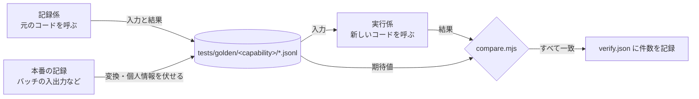

# 元のプログラムとの比較（比べ方 B1）

比べ方 A（仕様のシナリオから作ったテスト）は、AI が元コードを読んで書いた仕様と期待値で確かめます。元のプログラムは動かしていないので、同じ動きであることは「推定」です。B1 は、**元のプログラムが実際に返した結果**を記録し、同じ入力を新しいコードに通して、1件ずつ比べます。



| 役 | 書く人 | 言語 | 中身 |
|---|---|---|---|
| 記録係（recorder） | 実装担当（port の B1 タスク） | 移行元（C#・PHP など） | 入力の一覧を元のコードに通し、入力と結果をケースとして書く |
| 実行係（driver） | 実装担当（port の B1 タスク） | 移行先（TypeScript・Python・Java など） | 標準入力のケースを新しいコードに通し、結果を標準出力に書く |
| 比較 | キット（`scripts/compare.mjs`） | Node.js | 期待値と結果を比べ、違う箇所を示す |

## いつ使えるか

| 元のプログラム | B1 のケースの作り方 |
|---|---|
| ソースからビルドして手元で動かせる | 記録係が元のロジックを直接呼ぶ（画面やサインインは通さない） |
| 手元では動かないが、本番の実行の記録がある | バッチの入力と出力のファイル、帳票のデータ、プログラムが書いた行などを変換してケースにする |
| どちらもない | B1 は使えない。A だけになり、完了時に「推定」と知らせる |

## ケースの形式

`<移行先>/tests/golden/<capability の / を - にしたもの>/` の下の `*.jsonl` です（下のフォルダーも読みます）。1行に1ケースです。

```json
{"id": "invoice-month-end-01", "input": {"customer": "C001", "date": "2026-01-31"}, "expected": {"total": 10800, "tax": 800}}
{"id": "invoice-negative", "input": {"customer": "C001", "amount": -1}, "expected": {"error": "金額が不正です"}}
```

- `id` は空でない文字列で、フォルダー全体で重複できません。`input` と `expected` は任意の JSON です。ほかのキー（`note` など）は人のためのもので、比較では読みません。
- エラーも結果です。元のプログラムが例外やメッセージを返すなら、それを `expected` に書き、実行係も同じ形で返します。
- 文字コードは UTF-8 です（先頭の BOM と CRLF は読み替えます）。
- ケースは移行先のフォルダーの中に置きます。`gate.mjs port-done` はそれ以外の場所を受け付けません。移行先のハッシュにケースも入るので、verify のあとにケースを書き換えると、コードを書き換えたときと同じく port-done が止まります。

**期待値は元のプログラムからだけ取ります。** 新しいコードの結果を写したり、手で直したりすると、比べる意味がなくなります。記録が間違っていると思ったら、記録係でもう一度記録します。照合担当（port check）は、記録係が元のコードを呼んでいるか、いくつかの期待値が元コードをたどった値と合うかを確かめます。

## 比べ方の規則（rules.json）

ケースのフォルダーに `rules.json` を置くと、比べ方をゆるめられます。**どれも差を見逃す方向に働く**ので、port の design.md の Decisions に、規則ごとの理由を書きます（照合担当が確かめます）。

```json
{
  "ignore": ["$.createdAt", "$.lines[*].id"],
  "tolerance": 0.005,
  "numbersAsText": false,
  "trim": false,
  "unordered": ["$.lines"],
  "missingIsNull": false
}
```

| 規則 | 意味 | よくある理由 |
|---|---|---|
| `ignore` | このパスの値を比べない | 実行時刻、採番した ID |
| `tolerance` | 数値がこの幅まで違ってよい | 浮動小数点の誤差（金額の丸めには使わない。丸めは同じであるべき） |
| `numbersAsText` | `"12.50"` と `12.5` を同じとみなす | PHP が数値を文字列で返す |
| `trim` | 文字列の前後の空白を無視する | 固定長の CHAR 列 |
| `unordered` | この配列の順番を無視する | 元が ORDER BY のない SELECT（順番が仕様でないことを確かめてから） |
| `missingIsNull` | キーがないことと null を同じとみなす | シリアライザーの違い |

パスは `$` のあとに `.名前`、`[番号]`、`[*]`、`.*` を続けます（`$` は結果全体）。知らない規則名や書けないパスは、比較の失敗として報告します。

## port の design.md の書き方

```markdown
## Verification
| Level | Covers | Command |
|---|---|---|
| A scenario tests | every scenario | |
| B1 logic comparison | 請求額の計算（記録 120 件） | `spec-relay-compare --cases tests/golden/billing-invoice --driver "node tests/golden/driver.mjs"` |
```

- コマンドは移行先のフォルダーで実行します。`spec-relay-compare` はキットのコマンドで、`verify.mjs` がキットの compare.mjs で実行するので、キットの場所は書きません。
- `--driver` のコマンドは1つだけです（`a; b` やパイプは前の失敗が隠れるので受け付けません）。中で引用符が要るときは、外側と別の種類を使います（`--driver 'python -m tools.replay "x y"'`）。
- 実行係を使わず、新しいコードの結果を別の方法でファイルに書くときは `--driver` の代わりに `--actual <ファイル>` を使います（1行に `{"id": ..., "output": ...}`）。
- 時間の上限は verify の上限（既定 60 分）です。`--timeout-minutes N` で変えられます。

完了時（`gate.mjs port-done` が通ったとき）には、「B1: 元のプログラムから記録した 120 件がすべて一致」のように件数を知らせます。

## 実行係の例

実行係は、標準入力から1行に1つ `{"id": ..., "input": ...}` を読み、新しいコードに通して、標準出力に1行に1つ `{"id": ..., "output": ...}` を書きます。ログは標準エラーに書きます（標準出力に JSON 以外の行があると失敗にします）。

TypeScript / JavaScript（Node.js）:

```js
// tests/golden/driver.mjs
import readline from 'node:readline';
import { issueInvoice } from '../../src/billing/invoice.js';

for await (const line of readline.createInterface({ input: process.stdin })) {
  if (!line.trim()) continue;
  const { id, input } = JSON.parse(line);
  let output;
  try { output = issueInvoice(input); } catch (e) { output = { error: e.message }; }
  process.stdout.write(JSON.stringify({ id, output }) + '\n');
}
```

Python:

```python
# tests/golden/driver.py  (python -m tests.golden.driver)
import json, sys
from billing.invoice import issue_invoice

for line in sys.stdin:
    if not line.strip():
        continue
    case = json.loads(line)
    try:
        output = issue_invoice(case["input"])
    except Exception as e:
        output = {"error": str(e)}
    sys.stdout.write(json.dumps({"id": case["id"], "output": output}, ensure_ascii=False) + "\n")
```

Java では、テスト用のソースに `main` を持つクラスを置き、ビルドツールのタスク（Gradle の `JavaExec` など）で実行します。JSON は Jackson などで読み書きします。

Windows では、標準入出力の文字コードを UTF-8 にします（Python は `python -X utf8`、Java は `-Dstdout.encoding=UTF-8 -Dstdin.encoding=UTF-8` か `System.in` を UTF-8 で読む）。

## 記録係の例

入力の一覧（`inputs.jsonl`、1行に `{"id": ..., "input": ...}`）を元のコードに通し、ケースを書きます。入力は、仕様のシナリオすべてと、conventions.md の Language mapping にある境目（丸め、桁あふれ、null と空文字、日付と時差、並び順）から作ります。

C#（.NET Framework の古いアセンブリを参照するコンソール）:

```csharp
// tests/golden/recorder/Program.cs  (旧アセンブリ Billing.dll を参照)
using System; using System.IO; using Newtonsoft.Json; using Newtonsoft.Json.Linq;

class Program {
  static void Main(string[] args) {
    var calc = new Billing.InvoiceCalculator();
    using var output = new StreamWriter(args[1], false, new System.Text.UTF8Encoding(false));
    foreach (var line in File.ReadLines(args[0])) {
      if (string.IsNullOrWhiteSpace(line)) continue;
      var c = JObject.Parse(line);
      object expected;
      try { expected = calc.Issue((string)c["input"]["customer"], (DateTime)c["input"]["date"]); }
      catch (Exception e) { expected = new { error = e.Message }; }
      output.WriteLine(JsonConvert.SerializeObject(new { id = (string)c["id"], input = c["input"], expected }));
    }
  }
}
```

PHP（古いファイルを読み込む CLI スクリプト）:

```php
<?php
// tests/golden/recorder/record.php
// php tests/golden/recorder/record.php inputs.jsonl tests/golden/billing-invoice/recorded.jsonl
require __DIR__ . '/../../../../src/billing/invoice.php';  // 元のファイル（書き換えない）

$out = fopen($argv[2], 'w');
foreach (file($argv[1], FILE_IGNORE_NEW_LINES | FILE_SKIP_EMPTY_LINES) as $line) {
    $case = json_decode($line, true);
    try {
        $expected = issue_invoice($case['input']['customer'], $case['input']['date']);
    } catch (Throwable $e) {
        $expected = ['error' => $e->getMessage()];
    }
    fwrite($out, json_encode(['id' => $case['id'], 'input' => $case['input'], 'expected' => $expected], JSON_UNESCAPED_UNICODE) . "\n");
}
```

- 記録係は移行先のフォルダーの `tests/golden/recorder/` に置きます。移行元の言語で書きますが、元のフォルダー（読み取り専用）は書き換えません。照合担当が読めるように、コミットして残します。
- データベースを使うロジックは、data.md のテスト用データベースで記録し、新しいコードも同じ状態のデータベースで動かします。
- 時刻や乱数に依存する結果は、`ignore` にするか、記録係と実行係の両方で固定します（固定のしかたは design.md の Decisions に書きます）。

## 本番の記録を使うとき

元のプログラムを手元で動かせなくても、本番で動いた記録があれば B1 にできます。

- バッチ: 入力ファイルと出力ファイルの組。1組（または1行）を1ケースにします。
- 帳票: 帳票を作った条件と、帳票のデータ（CSV や中間ファイル）。
- 画面からの登録: 入力した値と、プログラムが書いた行（エクスポート）。

**個人情報は伏せてからリポジトリに入れます。** ケースはコミットされ、比較の結果はターミナルとチャットに表示されます。氏名・住所・電話番号・メールアドレス・口座などは、形を保ったまま置き換えます（同じ人は同じ値に）。変換のスクリプトは記録係と同じく port のタスクで書き、伏せ方を design.md の Decisions に書きます。

## 表示と終了コード

```
compare: 120 cases, 118 match, 2 differ
case invoice-month-end-07 (tests/golden/billing-invoice/recorded.jsonl:7):
  $.tax: expected 800, got 799
```

- 違うケースは最初の 20 件、1件あたり最初の 5 か所を示します。値は 80 文字までです。
- 終了コードは、すべて一致で 0、違いや問題があれば 1、使い方の誤りで 2 です。
- 単独でも実行できます: `node "<キットのフォルダー>/scripts/compare.mjs" --cases tests/golden/billing-invoice --driver "node tests/golden/driver.mjs" --cwd <移行先>`
