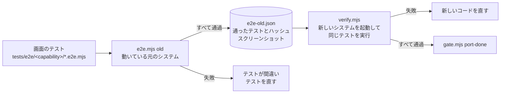

# 画面のテスト（比べ方 B2・C）

OpenSpec の仕様にはシナリオ（WHEN と THEN）が並んでいます。0.21.0 から、**すべてのシナリオに自動の確認を1つずつ付け**、確認がないシナリオがあると完了の確認（`gate.mjs port-done`）が止まります。確認の方法はシナリオの種類で選び、画面で行う操作は Playwright のテストにします。

いちばんの特徴は、**同じ Playwright のテストを、まず元のシステムに、次に新しいシステムに流す**ことです。画面はそのまま移すので、元のシステムで通るテストは、新しいシステムでも通るはずです。元のシステムで先に通すことで、テストそのものが正しいこと（AI が仕様を読み違えて、テストとコードが一緒に間違っていないこと）を元のシステムが保証します。



## シナリオごとの確認方法

port の design.md の `## Scenario checks` に、ベースラインのすべてのシナリオを1行ずつ書き、確認方法を1つ選びます。

| 確認方法 | 向いているシナリオ | 証拠として gate が見るもの |
|---|---|---|
| `e2e` | 利用者が web の画面で行う操作と、そこに出る表示 | 題名がシナリオの印の Playwright のテストが、元のシステムで通り、そのあと新しいシステムでも通ったこと |
| `compare` | API・バッチ・帳票など、入力と出力で表せるもの（B1、[COMPARE.md](COMPARE.md)） | 元のプログラムから記録したケースに、シナリオの印（`"scenario"` キー）があること。比較はすべてのケースが一致して通る |
| `unit` | 計算や判定の細かい分岐、デスクトップの画面（WinForms・WPF）、元のプログラムでは見せられないもの | 移行先の言語のテスト（`tests/e2e/` の外、データファイルではない）に印があること |

```markdown
## Scenario checks
| Requirement | Scenario | Check |
|---|---|---|
| 受注を検索する | 名前で検索する | e2e |
| 受注を検索する | 該当なし | e2e |
| 請求額を計算する | 月末締め | compare |
| 請求額を計算する | 端数の切り捨て | unit |
```

- B1 か B2 のコマンドがある port では、この表が必須です。どちらもない port（A だけ）は、すべて `unit` とみなすので、表は「None」でかまいません。
- 移行先の設計（verification.md）で B2 を選んだコンテキストでは、画面で行うシナリオはすべて `e2e` にします。照合担当が、画面のシナリオを `unit` に逃がしていないかを確かめます。
- 画面のない機能（解析の screens.md が `None` で、人がレビューの S0 で確かめたもの）には、B2 と C を適用しません。コンテキストで B2・C を選んでいても、`verify.mjs` は実行せず、design.md の Verification に B2・C の行は書きません。B2・C を選んだコンテキストのその機能では、`e2e` のシナリオ、`tests/e2e/<capability>/` の画面のテスト、B2・C の行のどれかがあると、`verify.mjs` は実行せず、`gate.mjs port-done` も止まります（画面があるなら解析をやり直して、画面をレビューしてもらいます）。仕上げ（finish）でも、すべての機能に画面がないコンテキストでは、checks.md の B2・C は `-` になります。決めるのはレビュー済みの screens.md だけで、port の中で「適用なし」と書く場所はありません。完了時には「B2・C（画面の比較）は行っていません。レビュー済みの解析の screens.md で、この機能には画面がないとされているため」と知らせます。
- E2E ですべてを確かめない理由: 細かい分岐を画面越しに確かめると、遅く、不安定になります。分岐は単体テストで、画面の流れは E2E で、と分けます。
- Playwright はブラウザしか操作できないので、WinForms・WPF・VB6 の画面のシナリオは `unit`（ロジックを呼べるなら `compare` も）です。

## 用意するもの

| もの | 誰が | 内容 |
|---|---|---|
| 元のシステムのテスト用の環境 | 人 | 手元の PC（`http://localhost:...`）で動かす。データベースもテスト用。**本番には向けない** |
| テスト用データベースを初期状態に戻す方法 | 人（verification.md に書く） | 新旧のどちらも、テストの前に同じ状態にする。1つのコマンドにできれば `--reset` で毎回自動で戻す |
| 画面のテストのフォルダー | 実装担当（最初の B2 の port） | `node "<キットのフォルダー>/scripts/e2e.mjs" init` で `tests/e2e/` を作り、そのフォルダーで `npm ci` |
| ブラウザ | — | Windows 11 は入っている Edge を使うので、ダウンロードは要りません。ほかの OS では `tests/e2e` で `npx playwright install chromium` を1回実行するか、環境変数 `SPEC_RELAY_E2E_CHANNEL=chrome` で入っている Chrome を使います |
| サインインの値 | 人が環境変数に設定 | テストでは `secret('名前')` で読む。ファイルには書かない |

`init` が作るファイル:

| ファイル | 中身 |
|---|---|
| `package.json`・`package-lock.json` | 版を固定した `@playwright/test`（キットがテストした版） |
| `playwright.config.mjs` | 新旧で共通の設定。ブラウザ（Windows は Edge）、言語 `ja-JP`、時間帯 `Asia/Tokyo`、画面の大きさ 1280×800、スクリーンショットはアニメーションとカーソルなし。移行のあいだ変えない |
| `support.mjs` | `secret(name)`（環境変数の値）、`at(path)`（元のパスを、新しいシステムでは capability のフォルダーの `paths.json` の対応で読み替える。`--base http://localhost/MyApp` のようにフォルダーの下で動くシステムでは、そのフォルダーを前に付ける）、`side`（old か new） |
| `.gitignore` | `node_modules/` |

キットは、この設定の上に自分の設定（`scripts/e2e-config.mjs`）を重ねて実行し、次のことは利用者の設定で変えられないようにします。

- 試すシステムのアドレス（元のシステム、次に新しいシステム）
- その capability のフォルダーの `*.e2e.mjs`（`.js`・`.ts`）だけを実行する。`only`・grep・除外は効かない
- 1つずつ順に実行し、やり直さない（テスト用データベースを共有するため。やり直すと、半分の確率で失敗するテストが通ってしまう）
- スクリーンショットは `<capability のフォルダー>/screenshots/` に、OS やブラウザの名前を付けずに置く。元のシステムの実行のたびに一度すべて消して撮り直し（もう撮らない古い画像は残らない）、新しいシステムの実行では書き換えない
- トレースは取らない（入力した値、パスワードも記録されるため）。失敗の詳細とスクリーンショットの差分は `openspec/spec-relay/local/e2e/` に出す（git は無視します）
- ブラウザの種類（プロジェクト）は1つだけ。プロジェクトに書けるのは名前とブラウザの設定（`use`）だけ
- 元のシステムの実行と新しいシステムの実行で、Playwright の版・ブラウザ（`SPEC_RELAY_E2E_CHANNEL`）・OS が同じこと。違うと、スクリーンショットを比べられないので止める

## テストの書き方

```js
// tests/e2e/orders-list/search.e2e.mjs
import { test, expect } from '@playwright/test';
import { at, secret } from '../support.mjs';

test('spec-relay: orders/list | 受注を検索する | 名前で検索する', async ({ page }) => {
  await page.goto(at('/login.php'));
  await page.getByLabel('ユーザー ID').fill(secret('OLD_APP_USER'));
  await page.getByLabel('パスワード').fill(secret('OLD_APP_PASSWORD'));
  await page.getByRole('button', { name: 'ログイン' }).click();

  await page.goto(at('/order_list.php'));
  await page.getByLabel('顧客名').fill('山田');
  await page.getByRole('button', { name: '検索' }).click();

  await expect(page.getByRole('row', { name: /山田商店/ })).toBeVisible();
  await expect(page.getByText('1 件')).toBeVisible();
  await expect(page).toHaveScreenshot('受注一覧.png');   // C を選んだときだけ
});
```

- **題名はシナリオの印そのもの**にします（`spec-relay: <capability> | <要件> | <シナリオ>`、名前はベースラインの仕様のとおり）。印のないテスト、ベースラインにないシナリオの印は、実行の時点で失敗にします。
- **要素は利用者と同じ見つけ方で指します**: `getByRole`・`getByLabel`・`getByText`、または文字で見つけた行やセルの中。id・class・テスト用 id（`getByTestId`）・XPath は、新旧で変わるので使えません（WebForms の `ctl00_Main_txtQty` は新しいシステムにはありません）。`e2e.mjs` がその capability のフォルダーのファイルを読んで、これらを見つけると実行しません。フォームの `name` は送る値の名前なので使えます。文字で見つけた要素の親（`locator('..')`）も使えます。
- ラベルのない入力欄（古いページによくあります）は、横に書かれた文字の行の中で探します（`page.getByRole('row', { name: '数量' }).getByRole('textbox')`）。
- ページを開くときは元のシステムのパスを `at()` で包みます。`http://...` の決まったアドレスや `baseURL` は書けません（実行ごとに、試すシステムのアドレスをキットが渡します）。新しいシステムでパスを変えると決めたときだけ、capability のフォルダーの `paths.json`（`tests/e2e/orders-list/paths.json`）に `{ "/order_list.php": "/orders" }` と書きます。差を見逃す方向に働くので、理由を design.md の Decisions に書きます。
- capability のフォルダーの外のファイル（`tests/e2e/` の直下を除く）は読み込めません。ハッシュで守られない場所に、テストの中身を逃がせないようにするためです。
- シナリオの WHEN を画面の操作で行い、THEN の値をすべて確かめます。ページが開いただけで通るテストは、照合担当が `mismatch` にします。
- `side`（old か new）で処理を分けてはいけません（見つけると実行しません）。両方で違うことを確かめるテストは、何も証明しません。
- 毎回変わる値（日時、採番）がスクリーンショットに入るときは、その部分だけ `mask` で隠し、理由を design.md の Decisions に書きます。`mask`・`maxDiffPixels`・`threshold` のような比べ方をゆるめる設定は、完了の確認で場所ごとに人に知らせます。
- 読み取りで見つけられるのは、よくある書き方だけです（文字列を組み立てたセレクターなどは見逃します）。残りは照合担当がテストを読んで確かめます。

## 実行する

### 1. 元のシステムで通す（port のタスク）

この実行は、実装担当（サブエージェント）ではなく、全体を進める AI（オーケストレーター）が行います。人が、テスト用の環境が verification.md に書いたアドレスで動いていて、データベースが初期状態であることを確かめてから実行します。

```powershell
node "<キットのフォルダー>/scripts/e2e.mjs" old --change port-orders-list --base http://localhost:8080 --reset "node tests/e2e/reset-db.mjs"
```

- 表示の例: `e2e: 12 tests passed on the old system at http://localhost:8080 (8 scenarios, 5 screenshots taken), recorded in openspec/changes/port-orders-list/e2e-old.json`
- `--base` は、移行先の設計の verification.md（元のプログラムの動かし方）に書いたアドレスでなければなりません。「元のシステム」の実行を、新しいシステムに向けられないようにするためです。
- すべてのテストが通ったときだけ `e2e-old.json` を書きます。通ったテストの一覧、アドレス、ブラウザと、その capability のフォルダーと `tests/e2e/` 直下のファイルのハッシュ（テスト・設定・スクリーンショット）が入ります。ほかの capability のテストを足しても、この記録は無効になりません。1つでも失敗したら書きません（前の記録も消します）。**元のシステムで失敗するテストは、テストが間違っています。** テストを直します。
- スキップしたテスト、やり直して通ったテストは、通ったものとみなしません。
- `--base` はこの PC だけです。ほかのホストのテスト用の環境は、人がそのホストを決めてから `--allow-host <ホスト名>` を付けます（AI が自分の判断で付けることはありません。port のコマンドには書けません）。
- `e2e-old.json` は `e2e.mjs` だけが書きます（フックが有効なら、AI の編集ツールとシェルでの書き込みを拒否します）。

### 2. 新しいシステムで通す（verify）

port の design.md の Verification に1行で書きます。C も選んだときは、C の行に同じコマンドを書きます（実行は1回で、両方の結果になります）。

```markdown
| B2 screen tests | 受注一覧・受注の編集 | `spec-relay-e2e --base http://localhost:3000 --start 'npm --silent start' --reset 'node tests/e2e/reset-db.mjs'` |
| C screenshots | 受注一覧・受注の編集 | `spec-relay-e2e --base http://localhost:3000 --start 'npm --silent start' --reset 'node tests/e2e/reset-db.mjs'` |
```

`verify.mjs` がこのコマンドを `e2e.mjs` で実行し、次の順に進みます。

1. `tests/e2e/` が、元のシステムで通ったときから変わっていないことを確かめる（変わっていたら、変わったファイルを示して止める）
2. 元のシステムが止まっていることを確かめる（元のアドレスがまだ応答すると止める。テストが元のシステムに届かないようにするため）。元のシステムでの実行と同じアドレスで新しいシステムを試すことはできません
3. `--reset` のコマンドでデータベースを初期状態に戻す
4. `--start` のコマンドで新しいシステムを起動し、応答するまで待つ（既定 60 秒、`--wait-seconds N`）。起動の前にすでに何かが応答していると止める
5. 同じテストを、元のシステムで撮ったスクリーンショットと比べながら実行する
6. 新しいシステムを止める
7. 元のシステムで通ったテストと**まったく同じテスト**がすべて通ったときだけ合格。片方でしか動かなかったテストも失敗にする

結果は `verify.json` に、テストの数・通ったテストの題名・スクリーンショットの数・`tests/e2e/` のハッシュとして残り、`gate.mjs port-done` がシナリオごとに確かめます。完了時には「B2: 画面のテスト 12 件が、元のシステム（http://localhost:8080、2026-11-19 の実行）で通ったあと、新しいシステムでも通過」「C: 元のシステムで撮った 5 枚のスクリーンショットと新しい画面が一致」「シナリオ 20 件の確認方法: 画面のテスト 12 件、記録との比較 5 件、単体テスト 3 件」のように知らせます。

**新しいシステムで失敗したら、新しいコードを直します。** テストやスクリーンショットを直すのは、元のシステムでもう一度通すときだけです。スクリーンショットが違うときは、`openspec/spec-relay/local/e2e/<capability>/new/results/` に、元・新・差分の画像が出ます。

### 仕上げ（finish）で全体をもう一度

後の port が先の画面を壊していないかを、capability ごとに確かめます。

```powershell
node "<キットのフォルダー>/scripts/e2e.mjs" new --capability orders/list --base http://localhost:3000 --start "npm --silent start" --reset "node tests/e2e/reset-db.mjs"
```

その capability の archive 済みの port で、元のシステムで通ったテストを使います。

## 新旧でデータベースをそろえる

画面のテストは画面越しにデータを書き換えるので、新旧の結果は最初のデータで変わります。

- 新旧のテスト用データベースは、同じ定義（`openspec/spec-relay/db/`）と同じ初期データから作ります（data.md の Test database）。
- 初期状態に戻すコマンドを1つ用意し、`--reset` に渡します。新旧で同じコマンドが使えると、比べる条件がそろいます。
- テストは1つずつ順に、ファイルの名前順に実行されます。あるテストが前のテストの書いたデータに頼るときは、同じファイルに順に並べます。

## この方法の限界

- 元のシステムを手元で動かせないコンテキストでは使えません。そのときは A（と、本番の記録があれば B1）になり、完了時に「推定」と知らせます。
- Playwright はブラウザだけを操作します。デスクトップの画面のスクリーンショットの比較（C）は、今も port のタスクとして AI が書きます。
- スクリーンショットは同じ PC・同じブラウザで撮ったものどうしを比べる前提です。フォントや画面の倍率が変わると差が出るので、元のシステムでの実行と新しいシステムでの実行は同じ PC で行います。
- ファイルのダウンロードの中身は比べません。帳票やダウンロードの中身は B1（`compare`）で確かめます。
