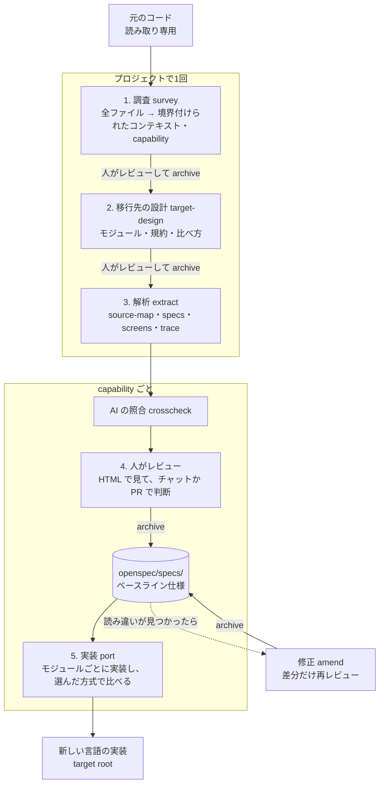
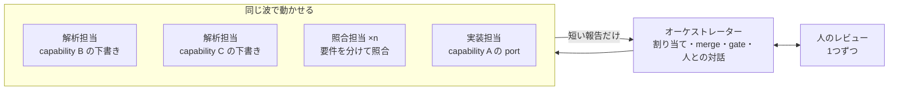

# spec-relay の流れと設計

この文書は、spec-relay の工程・成果物・判断の根拠をまとめたものです。オーケストレーターの手順そのものは [skills/spec-relay/SKILL.md](../skills/spec-relay/SKILL.md) にあり、こちらはその背景です。

## 全体像



最初に1回だけ、コード全体を読んで **境界付けられたコンテキスト**（DDD）に分け（工程 1）、新しいシステムの作りを決めます（工程 2）。そのあとは **capability（機能のまとまり）** ごとに「解析 → レビュー → 実装」を回すので、全体を解析し終える前に、レビュー済みのものから実装を始められます。capability の名前は `<コンテキスト>/<名前>`（例 `billing/invoice`）です。

## OpenSpec の使い方

spec-relay は OpenSpec の仕組みをそのまま使い、独自のスキーマを5つ足します。

| OpenSpec の概念 | spec-relay での意味 |
|---|---|
| `openspec/specs/` | レビュー済みの **ベースライン仕様**。新しい実装が満たすべき契約 |
| change `survey`（スキーマ `spec-relay-survey`） | コンテキストの地図と capability の一覧（工程 1） |
| change `target-design`（スキーマ `spec-relay-target`） | 移行先の設計（工程 2） |
| change `extract-<capability>`（スキーマ `spec-relay-extract`） | 元のコードから仕様を起こす作業（工程 3・4） |
| change `port-<capability>`（スキーマ `spec-relay-port`） | ベースライン仕様を新しい言語で実装する作業（工程 5） |
| change `amend-<capability>`（スキーマ `spec-relay-amend`） | ベースライン仕様の読み違いを直す作業 |
| apply | port では実装、それ以外では **人間のレビュー** |
| archive | port では完了、それ以外では **承認**。extract と amend は仕様をベースラインに反映する |
| `openspec/config.yaml` の context | 移行元・移行先の言語とフォルダー。全成果物の生成に注入される |

同じ名前の change は同じ日に2回 archive できない（OpenSpec 1.17.0 で確認）ため、2回目の survey・port・amend には `-v2` のような接尾辞を付けます。スクリプトはこれを同じ change として扱います。

### 工程 1：調査（survey）の成果物

| 成果物 | 中身 |
|---|---|
| `inventory.md` | すべての元ファイルと、属するコンテキスト（または除外とその理由）。フォルダー単位でも書ける |
| `context-map.md` | コンテキストごとの責務・持っているデータ・入口・根拠、コンテキスト間の関係（上流・下流、共有カーネル、腐敗防止層など）、複数から書き込まれるデータの持ち主、図 |
| `glossary.md` | コンテキストごとの業務の言葉と、コード上の名前。同じ言葉が別の意味で使われる箇所 |
| `capabilities.md` | コンテキストごとの capability と移行の順番（`platform` が最初）。archive 後に plan.md へ写す |
| `review.md` | コンテキストごとの確認と、関係・データの持ち主・順番の確認 |

古い C# や PHP は境界がきれいに分かれていないことが多いので、境界はデータの持ち主（どのコードがどのテーブルに書き込むか）、業務の言葉、トランザクションの範囲、呼び出しの結びつき、画面やメニューのまとまりを根拠に AI が案を出し、人が決めます。何でもやるクラスや共通 include はメソッド単位で振り分け、認証・ログ・共通レイアウトなどの技術的な共通部分は `platform` にまとめます。`gate.mjs review` は、元ファイルが1つでも inventory から漏れていると止まります。

### 工程 2：移行先の設計（target-design）の成果物

| 成果物 | 中身 |
|---|---|
| `architecture.md` | モジュール構成。既定は Spring Modulith 型のモジュラーモノリス（コンテキストごとに1モジュール、外に見せるのは公開 API とイベントだけ、テーブルの持ち主は1モジュール、境界を自動テストで確認） |
| `conventions.md` | 全 port 共通のルール。ランタイムとフレームワーク、言語の意味の違い（数値と丸め、文字コード、日付、null、例外など）、コーディング規約、コマンド |
| `verification.md` | コンテキストごとの比べ方と、元のプログラムの動かし方、サインインの扱い、記録データの置き場所 |
| `review.md` | 上の各項目の確認 |

境界の確認に使う道具の例：Java は Spring Modulith（`ApplicationModules.verify()`）や ArchUnit、TypeScript は dependency-cruiser や eslint-plugin-boundaries、Python は import-linter、C# は ArchUnitNET や NetArchTest。

比べ方はコンテキストごとに選びます。

| 方式 | 比べるもの | 重さ |
|---|---|---|
| A（必須） | 仕様のシナリオから作ったテスト | 軽 |
| B1 | 元コードの計算や検証を画面を通さず直接呼び、記録した入出力と新しい実装を比べる | 中 |
| B2 | ブラウザ操作を Playwright で記録し、新旧で再生して比べる | 重 |
| C | 画面のスクリーンショットを新旧で比べる | 中 |

B1 は画面もサインインも通さないので、元のコードが手元でビルドして動けば使えます。B2 と C のサインインは、人が設定する環境変数から読み、パスワードなどをファイルに書きません。

### 工程 3：解析（extract）の成果物

| 成果物 | 中身 | 誰が使うか |
|---|---|---|
| `source-map.md` | 範囲のファイル・入口・依存・範囲外 | レビュー担当、工程 5 |
| `specs/<capability>/spec.md` | 今の動作を言語に依存しない形で書いた要件とシナリオ | すべての工程の契約 |
| `screens.md` | 画面ごとの入口・配置・項目（ラベルは原文のまま）・操作・メッセージ・遷移・スクリーンショット | 工程 5 の画面の再現、比べ方 C |
| `trace.md` | 要件ごとの元コードの位置（パス・シンボル・行）と既存テスト | 工程 5 の実装担当 |
| `crosscheck.md` | 別の AI（`spec-relay-checker`）が要件と画面を元コードと突き合わせた結果 | レビュー担当の負担を減らす |
| `questions.md` | バグの疑い・曖昧な点・推測・移行しないもの | レビュー担当が判断する |
| `review.md` | 要件・画面・質問・網羅性のチェックリスト | レビュー担当がチェックする |

仕様（spec）にはクラス名や関数名を書かず、元コードの位置は trace.md に分けます。仕様を新しい言語にも通用する契約に保ちながら、実装時には元のロジックへすぐたどれるようにするためです。

照合担当は、解析担当のメモや下書きを見ずに、仕様・画面・trace と元コードだけから判断します。書いた本人でない目で確かめるためです。`mismatch`（食い違い）と `unclear`（コードから決まらない）は、直して照合し直すか、質問に回すまで `gate.mjs review` を通りません。

### 工程 5：実装（port）の成果物

| 成果物 | 中身 |
|---|---|
| `proposal.md` | 対象の capability、移行先、順番の理由、範囲外、着手時のベースラインのハッシュ |
| `design.md` | モジュール内の構成、規約への追加、画面の再現方法、比べ方、要件ごとの元コード参照 |
| `tasks.md` | 要件・移行先ファイル・参照する元コード・確認方法を書いたタスク。最後に境界の確認 |

port は動作を変えないので、spec の差分を持ちません（`skip_specs: true`。OpenSpec が自動で付けます）。

### 修正（amend）

実装中などに、ベースライン仕様が元コードの動きを読み違えていたと分かったときの手順です。OpenSpec の差分（MODIFIED・ADDED・REMOVED）で直す要件だけを書き、AI の照合と人のレビューを受けて archive すると、ベースラインに反映されます。

| 成果物 | 中身 |
|---|---|
| `reason.md` | 何を読み違えていたか、元コードの根拠 |
| `specs/<capability>/spec.md` | 直す要件だけの差分 |
| `trace.md` | 直した要件の元コードの位置。port はこちらを優先して読む |
| `crosscheck.md` | 直した要件の照合 |
| `impact.md` | 影響する port と、そこでやること |
| `review.md` | 直した要件と影響の確認 |

- 直してよいのは読み違いだけです。動きそのものを変えたい（バグを直すなど）ときは、移行後の別作業にします。
- MODIFIED は要件を丸ごと置き換えます。OpenSpec は、ベースラインにあるシナリオが抜けた MODIFIED を archive しない（1.17.0 で確認）ので、既存のシナリオ名は残して中身を直します。
- port は着手時のベースラインのハッシュを proposal.md に記録します（`gate.mjs baseline`）。修正が archive されてハッシュが変わると `gate.mjs port-done` が止まるので、古い仕様のまま実装を終えることはありません。

## 並列での進め方

人のレビューは並列にできない1本の作業です。キットはその前後の AI の作業をサブエージェントで同時に進め、人がレビューを1つ終えたときに次のレビューが用意できている状態を目指します。並列化は1つのセッションの中だけで行い、Copilot CLI・VS Code（Copilot ハーネス）・Copilot app で同じ手順です。サブエージェントを順番にしか動かせないホストでも、結果は同じで遅くなるだけです。



| 工程 | 並列にするもの | 直列のまま |
|---|---|---|
| 1. 調査 | inventory をフォルダーごとに解析担当へ。glossary と capabilities | コンテキストの地図（全体を1人が見て決める） |
| 2. 移行先の設計 | conventions と verification。調査のレビュー中に人へ質問しておく | architecture（コンテキストの地図に依存） |
| 3. 解析 | capability 同士の下書き（`ahead` 件まで）。大きい capability の specs と screens、照合の分割。移行先の設計のレビュー中にも始めてよい | 1つの change の source-map → trace → 照合の順 |
| 4. レビュー | ― | 人が1つずつ |
| 5. 実装 | 実装担当1つと、ほかの capability の解析・照合を同じ波で | port は同時に1つ（移行先のビルド定義などを共有するため） |

決めたこと：

| 決めたこと | 理由 |
|---|---|
| サブエージェントは割り当てられたファイルを自分で書き、短い報告だけを返す | 成果物の全文をオーケストレーターが受け取って書き写すと、並列の数だけ文脈が埋まり、圧縮で手順や約束事を忘れやすくなる。オーケストレーターは指示も中継せず、スキーマのパスを渡す |
| 1つの波で同じファイルを書くサブエージェントは1つだけ | 同じ作業フォルダーを共有するため。分担する表（inventory・crosscheck）は作業フォルダー `openspec/spec-relay/work/<change>/` に別々のファイルとして書き、`scripts/merge.mjs` が1つにまとめる。merge.mjs は作業フォルダーの外を部品として読まず、進行中の change の成果物（review.md を除く）にしか書かない。同じ R 番号に別の名前が来たら止まる |
| 波の前後で `gate.mjs guard` と `git status` を比べる | 解析担当と照合担当は書く権限を持つようになったので、割り当て外のファイルが変わっていないかを確かめる。review.md・ベースライン仕様・config.yaml は `gate.mjs guard` のハッシュで（git は追跡していない review.md のチェックを見分けられない）、元コードは `git status` で見る（追跡済みのファイルの変更と新しいファイル）。フックで物理的に止めるのは今後の課題 |
| review.md・plan.md・questions.md、openspec のコマンド、archive はオーケストレーターだけ | 人の判断と関門に関わる所を1か所に保つ |
| 同時に動かす数は設定（既定 4） | Copilot CLI のリファレンス（2026-11-10 時点）では契約ごとに上限が違い（Free 2、Pro 4、Max 8、Business 16、Enterprise・従量課金 32、孫も含めたセッション全体）、超えた起動は待たずに断られる。断られたら1つ終わるのを待って起動し直す。VS Code と Copilot app の上限は公式に書かれていない |
| サブエージェントのモデルも設定（役割ごと、既定はセッションと同じ） | プラグインのエージェント定義は全リポジトリで共通なので、リポジトリごとのモデルはオーケストレーターが頼むときに指定する。呼び出しごとの指定は Copilot CLI と VS Code の Local ハーネスで公式、Copilot ハーネスと app は未記載。セッションが Auto のときはセッションのモデルになる |
| 波は一度に起動し、全部を待つ | Copilot CLI は「可能なところは並列に動かす」と書き、SDK は本当に並列にするならバックグラウンドのサブエージェントを使うよう勧めている |
| 先に解析しておくのは `ahead` 件（既定 2）まで | レビューで見つかった読み違いの癖や用語の直しを次の解析に生かすため。待ち行列が長いと古くなり、人の負担も増える |
| 最初の capability（`platform`）は単独で解析する（最初のレビューが終わるまで `nextToAnalyze` は1件） | 書き方と照合の精度を、並列に広げる前に人のレビューで固める |
| 解析は移行先の設計を待たない | extract は言語に依存しない仕様で、調査の用語集と capability の一覧だけを使う。`gate.mjs` も設計の完了を求めていない |

`status.mjs --format todo` の `parallel` が、同時に動かせる数・先行できる数・解析中とレビュー待ちの capability・次に解析を始めてよい capability を出します。TODO には、いまの capability の3工程に加えて、並行して動いている capability を1行ずつ出します。

## 人間のレビューの守り方

このキットの要は人間のレビューです。調査・移行先の設計・解析・修正のどれも、次の仕組みで守っています。

1. **見やすくする**：`scripts/render.mjs` が成果物の markdown を1枚の HTML にします（`spec-relay-view` スキル）。デザインはスクリプトに固定しているので、どのモデルでも同じ見た目になります。HTML は表示用で、正は markdown です。
2. **先に AI が照合する**：解析と修正では、別の AI が要件と画面を元コードと突き合わせ、誤りを人のレビューの前に落とします。
3. **レビューの場所を選べる**：チャットで1項目ずつでも、ファイルや GitHub の PR で人がまとめて見て、終わったら AI に伝える形でもかまいません。
4. **手順**：スキルとエージェントの指示で、AI は人が認めた項目だけをチェックし、明示的な承認なしに archive しない。直した項目はチェックを外して確認し直す。
5. **機械的な確認**：`openspec archive --yes` は未チェックの項目や、チェックリストに載っていない要件があっても止まらない（1.17.0 で確認）。そこで archive の前に `scripts/gate.mjs review` を実行し、すべての要件・画面・質問・コンテキストに項目があること、すべてチェック済みであること、質問ごとの判断とレビュー担当の名前が書かれていること、照合が解決していること、元ファイルがすべて inventory にあることを確かめる。
6. **抜け道を外す**：OpenSpec 標準の apply・archive・sync のスキルとコマンドは、チェックを付けて archive まで進めてしまうため、導入スクリプトが中身をオーケストレーターへの案内に置き換える（ファイルを消すと、`openspec update` が利用者の OpenSpec 全体のプロファイルを狭めてしまうため、消さない）。
7. **記録**：review.md の各項目と質問への判断が change と一緒に archive に残る。

AI が自分でチェックを付けること自体を仕組みで止める（フックでの拒否）こと、チェック後に内容が変わったことを検出する（レビュー時点のハッシュ）ことは、次の段階の課題です（下の「今後の課題」）。

## 進捗の表示（Copilot の TODO）

進捗は Copilot が標準で持つ TODO リストに出します。オーケストレーターが `scripts/status.mjs` を実行し、その結果をホストの TODO ツールに渡します。

```text
- [ ] 全体: 12機能のうち3機能が移行済み（仕様確定 5）
- [x] billing/invoice: 解析
- [ ] ▶ billing/invoice: レビュー【レビュー待ち 3/8】 ← いまここ
- [ ] billing/invoice: 実装
```

| 決めたこと | 理由 |
|---|---|
| 全体1行と、いまの capability の3工程、並行して動いている capability を1行ずつ出す | capability が数十あっても TODO が短いままで、今どこで次に何をするかが一目で分かる。全体の表は `--format markdown` でチャットに出す |
| 状態は OpenSpec のファイルだけから計算する | TODO はセッションごとに消える。正本は `openspec/` に置き、毎回そこから作り直せば、再開しても食い違わない |
| 人を待つ工程は「未着手」のまま、題名に理由を書く | どのホストも状態は「未着手・進行中・完了」の3つだけ。「進行中」は AI が作業している工程に限る（並列のときは複数） |
| TODO のチェックは承認にならない | 承認は今までどおり、チャットでの人の明示的な返事と `gate.mjs` |
| TODO 用の JSON（`--format todo`）は ASCII だけで出す（日本語は `\uXXXX`） | Windows のコンソールのコードページ（cp932 など）を通っても題名が化けない |
| 毎回の報告の先頭にも同じ一覧を出す | ツール呼び出しが成功しても画面に出たとは限らない。TODO が使えないホストでもチャットで進捗が分かる |

各ホストの TODO（2026-11-10 時点の公式情報）：

| ホスト | ツール | 表示 |
|---|---|---|
| Copilot CLI | `update_todo`（エージェントの `todo` 指定は 1.0.100 から有効）。Markdown のチェックリストを1つ渡す | タイムラインに出る |
| VS Code（Local ハーネス） | `todo`。項目の配列（`id`・`title`・`description`・`status`）を渡す | Chat ビュー上部の Todo 欄 |
| VS Code（Copilot ハーネス）・Copilot app | `todo` に対応（Copilot app は Copilot CLI がもと） | 公式の記載なし。実機で確認する |

サブエージェント（解析担当・実装担当）は TODO を更新できません（VS Code の Local ハーネスでは公式に使えないと明記）。TODO を持つのはオーケストレーターだけです。

`plan.md` の `## Capabilities` の下に、字下げしない項目として並べた capability を、計画の順に数えます。下に `###` の見出し（たとえば境界づけられたコンテキストごと）を置いてもかまいません。計画にない仕様は表には出しますが、件数には入れません。計画が読めないとき、名前が衝突するとき、アーカイブ済みなのにベースライン仕様がないときなどは `problems` に出し、「すべて移行済み」とは表示しません。

工程は `status.mjs` の `STEPS` にデータとして並べてあり、成果物の数は change のスキーマ（`openspec/schemas/*/schema.yaml`）から数えます。成果物や工程を増やすときは、スキーマや `STEPS` に1項目足すだけで済みます。

## 先行例（code-migration-kit-with-github-copilot）から引き継いだこと

| 項目 | 先行例 | spec-relay |
|---|---|---|
| 入口 | オーケストレーター1つ | 同じ（`spec-relay-orchestrator`） |
| 配布 | Agent Plugins 1.0（`plugin.json`・`skills/`・`com.github.copilot/agents/`） | 同じ配置 |
| 対応アプリ | Copilot CLI・VS Code・Copilot app | 同じ |
| 手順の置き場所 | 非表示のスキル | 同じ |
| 元コード | 書き換えない | 同じ |
| 工程の記録 | キット独自の記録とハッシュ | OpenSpec の change と archive |
| 翻訳の単位 | ファイル | capability（仕様の単位）。その上にコンテキスト |
| 仕様 | 原則なし（ルールブックで変換） | 仕様が契約。元コードは詳細の参照 |
| 独立した確認 | 2人のレビュー担当と仲裁役 | 照合担当（`spec-relay-checker`）と人のレビュー |
| 元との比較 | parity 工程 | 比べ方 A・B1・B2・C をコンテキストごとに選ぶ |

## 今後の課題

- 並列化の次の段階（未決定）：人のレビュー中も AI が解析と実装を進められるよう、レビュー用と作業用のセッションを分ける。コンテキストごとの port を別の worktree のセッションで進め、PR で合流する（capability の依存関係を計画に持たせ、`gate.mjs port-ready` で依存先の実装を確かめる必要がある）。

- フック（`com.github.copilot/hooks`）で、元コードへの書き込み、AI による review.md のチェック、`gate.mjs` を通らない archive を拒否する。
- レビュー時点の spec・trace・questions のハッシュを記録し、チェック後に内容が変わったら gate で落とす。
- 解析担当・照合担当・実装担当をモデルから勝手に呼ばれないようにする（先行例は `disable-model-invocation: true` とランナー経由の起動。spec-relay はオーケストレーターがサブエージェントとして呼ぶため、ホストごとの挙動を確かめてから決める）。
- 調査の補助：呼び出し関係やテーブルへの書き込みを機械的に集める道具（C#・PHP 向け）。今は AI が読んで集める。
- 比べ方 B1・B2・C の実行を助けるスクリプト（入出力の記録と比較、スクリーンショットの差分）。今は port のタスクとして AI が書く。
- サブエージェントのモデル指定が各ホストで効くかを実機で確かめる。呼び出しごとの指定が効かないホストでは、導入時にリポジトリの `.github/agents/` へモデル入りのエージェント定義を置く方法（Copilot CLI では同じ名前のプラグインのエージェントより優先されると公式に記載）を検討する。
- 実アカウントでの Copilot CLI・VS Code・Copilot app の動作確認（まず Windows で）。TODO が各ホストの画面にどう出るかも、このときに確かめる。 並列化では、4件以上のサブエージェントが実際に同時に動くか、上限を超えたときの表示、Business の現在の既定値（CLI 1.0.106・1.0.107 で引き上げと記載、数値なし）、VS Code の両ハーネスでプラグインの3エージェントがサブエージェントとして選べるか、Manual 許可で並列の編集がどう確認されるかも確かめる。
- キットを更新したときに、導入済みリポジトリのスキーマを新しい版へ更新する手順（今は「キットの版と違う」と表示して止まる）。
