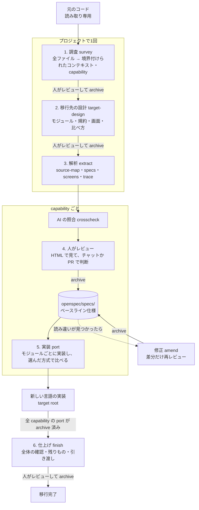
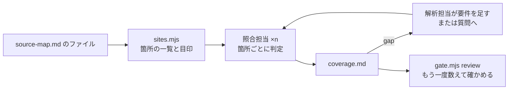
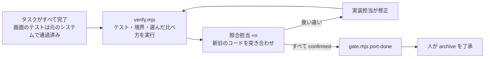
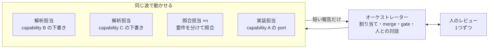
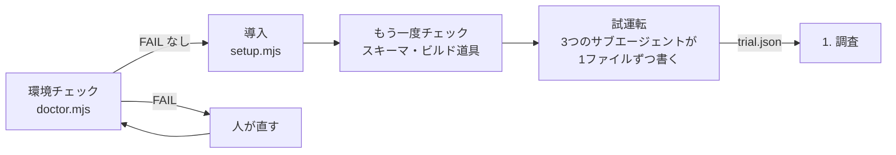

# spec-relay の流れと設計

この文書は、spec-relay の工程・成果物・判断の根拠をまとめたものです。オーケストレーターの手順そのものは [skills/spec-relay/SKILL.md](../skills/spec-relay/SKILL.md) にあり、こちらはその背景です。

## 全体像



最初に1回だけ、コード全体を読んで **境界付けられたコンテキスト**（DDD）に分け（工程 1）、新しいシステムの作りを決めます（工程 2）。そのあとは **capability（機能のまとまり）** ごとに「解析 → レビュー → 実装」を回すので、全体を解析し終える前に、レビュー済みのものから実装を始められます。capability の名前は `<コンテキスト>/<名前>`（例 `billing/invoice`）です。

## OpenSpec の使い方

spec-relay は OpenSpec の仕組みをそのまま使い、独自のスキーマを5つ足します。

| OpenSpec の概念 | spec-relay での意味 |
|---|---|
| `openspec/specs/` | レビュー済みの **ベースライン仕様**。新しい実装が満たすべき契約 |
| change `survey`（スキーマ `spec-relay-survey`） | コンテキストの地図と capability の一覧（工程 1） |
| change `target-design`（スキーマ `spec-relay-target`） | 移行先の設計（工程 2） |
| change `extract-<capability>`（スキーマ `spec-relay-extract`） | 元のコードから仕様を起こす作業（工程 3・4） |
| change `port-<capability>`（スキーマ `spec-relay-port`） | ベースライン仕様を新しい言語で実装する作業（工程 5） |
| change `amend-<capability>`（スキーマ `spec-relay-amend`） | ベースライン仕様の読み違いを直す作業 |
| change `finish`（スキーマ `spec-relay-finish`） | 全部の port のあとの、全体の確認と引き渡し（工程 6） |
| apply | port では実装、それ以外では **人間のレビュー** |
| archive | port では完了、それ以外では **承認**。extract と amend は仕様をベースラインに反映する |
| `openspec/config.yaml` の context | 移行元・移行先の言語とフォルダー。全成果物の生成に注入される |

同じ名前の change は同じ日に2回 archive できない（OpenSpec 1.17.0 で確認。2.1.1 でも archive の処理は変わっていない）ため、2回目の survey・port・amend には `-v2` のような接尾辞を付けます。スクリプトはこれを同じ change として扱います。

### 工程 1：調査（survey）の成果物

| 成果物 | 中身 |
|---|---|
| `inventory.md` | すべての元ファイルと、属するコンテキスト（または除外とその理由）、扱い（`port` は書き直す、`carry` は変換せずそのまま持っていく）。フォルダー単位でも書ける |
| `context-map.md` | コンテキストごとの責務・持っているデータ・入口・根拠、コンテキスト間の関係（上流・下流、共有カーネル、腐敗防止層など）、複数から書き込まれるデータの持ち主、図 |
| `glossary.md` | コンテキストごとの業務の言葉と、コード上の名前。同じ言葉が別の意味で使われる箇所 |
| `capabilities.md` | コンテキストごとの capability と移行の順番（`platform` が最初）、capability ごとの元ファイル・フォルダー。archive 後に plan.md へ写す |
| `database.md` | 使っているデータベース、定義の場所（リポジトリのファイルか、人が書き出した `openspec/spec-relay/db/`）、DB の中のロジックの種類と数、取れなかった定義、定義全体のハッシュ |
| `review.md` | コンテキストごとの確認と、関係・データの持ち主・言葉の衝突・順番・carry のファイル（M1〜M5）・除外したファイル（C1）の確認、データベースごとの確認。M1〜M5 と C1 は、消すと `gate.mjs review` が止める。除外した行は、理由が Notes の欄にないと止める |

古い C# や PHP は境界がきれいに分かれていないことが多いので、境界はデータの持ち主（どのコードがどのテーブルに書き込むか）、業務の言葉、トランザクションの範囲、呼び出しの結びつき、画面やメニューのまとまりを根拠に AI が案を出し、人が決めます。何でもやるクラスや共通 include はメソッド単位で振り分け、認証・ログ・共通レイアウトなどの技術的な共通部分は `platform` にまとめます。`gate.mjs review` は、元ファイルが1つでも inventory から漏れているとき、除外していないファイルがどの capability にも入っていないときに止まります。どの capability にも入らないファイルは仕様にならず、新しいシステムから黙って消えるためです。除外してよいかは人が決めるので、レビューの網羅性の項目は「除外したファイルを本当に移行しなくてよいか」の1つだけです。

### ファイル単位の網羅（抜けの検出）

capability ごとの元ファイルは、capabilities.md（archive 後は plan.md）で各 capability の下に字下げした項目として書きます（`` - `src/billing/` ``。フォルダーは末尾に `/`）。別の capability の下に、より細かいパス（ファイル）を書くと、そちらが優先します。何でもやるクラスのように1つのファイルを分けるときは、そのファイルを関係する capability すべての下に書きます。

| いつ | 確かめること |
|---|---|
| 調査の `gate.mjs review` | 除外していないファイルが、どれかの capability に入っている。書いたパスにファイルがある。除外したファイルに理由がある |
| 解析の `gate.mjs review` | source-map.md に、plan がその capability に割り当てたファイルがすべてある。source-map と trace に書いたパスが存在する。trace の行番号がそのファイルの中にある。すべての要件に trace の行がある |
| `gate.mjs coverage` | plan 全体で上の2つ。調査のあとに増えたファイル。まだ解析していない capability の一覧 |

解析担当が「このファイルは別の capability のもの」と報告したら、オーケストレーターが plan.md の行を移し、`gate.mjs coverage` で確かめます。移した先の capability の extract がすでに archive 済みなら、そのファイルの動作は修正（amend）で仕様に足し、その change に移したファイルを書いた source-map.md を置きます。plan に capability があれば、その一覧が正です（名前の変更や統合は plan が勝ちます）。plan に元ファイルを1つも書いていない間は、capability ごとに調査の capabilities.md の割り当てを使い、1つでも書いたら plan の割り当てだけを使います。元ファイルのない capability は gate が止めます。ファイルの中の動作（分岐や例外など）の抜けは、この確認では分からないので、次の箇所台帳で見ます。

### 箇所台帳（ファイルの中の抜けの検出）

照合（crosscheck）は「仕様に書いたことが正しいか」を確かめますが、「書いていない動作」は探しません。そこで解析では、照合と同じ波で抜けの確認もします。



| 誰が | やること |
|---|---|
| 機械（`scripts/sites.mjs`） | source-map のファイルから「箇所」を数える。C#・Java はメソッド・コンストラクター・本体のあるプロパティ・定数、VB.NET は Sub・Function・Property・定数、PHP・JavaScript・TypeScript は関数・メソッド・クラス定数、SQL はストアドプロシージャ・関数・トリガー・ビュー。列挙型の値は `<列挙型>.(values)` という1箇所（C#・Java・VB.NET・TypeScript。PHP の enum の case は `(file)`）。どの箇所にも入らず、何かをしている行（関数の外のページのコードと HTML、トップレベルの文、フィールドの初期値、属性やアノテーション（`[Required]` などの入力チェック、ルート、権限）、プロシージャの外の SQL、認識できなかったコード）は、ファイルごとの `(file)` という箇所に行番号つきでまとめる。それ以外の言語のファイル（.aspx、設定ファイルなど）は丸ごと `(file)`。箇所ごとに、DB への書き込み・例外・リダイレクト・メール・セッション・現在時刻・丸めなどの目印の行も出す |
| 照合担当（AI、解析担当とは別） | 箇所ごとに、外から見える動き（結果・エラー・書き込み・メッセージ・目印の行）が、どの要件のシナリオやどの画面にあるかを判定する。`covered R3, S1`・`no behavior`・`other capability <path>`・`question Q2`・`gap` |
| gate | 箇所をもう一度数え、行のない箇所、存在しない箇所の行、同じ箇所の2つの行、空や `gap` の判定、存在しない要件・画面・質問・capability を指す判定、根拠のない「動作なし」、元に戻ってくる「別の capability」の連鎖、読めないファイルを指す source-map の行があると止める。0.20.0 から、**`covered` とした箇所の「効果のある行」に、名前を挙げた要件の trace が届いていないとき**と、**目印のある箇所を「動作なし」としたのに人の確認項目（C1）がないとき**も止める（下の説明） |
| 人 | レビュー画面の冒頭に集計が出る。質問に回った箇所はいつもの質問として判断する。「動作なし」としたのに目印がある箇所は一覧で出るので、目を通して review.md の C1 にチェックを付ける。`covered` の行を1件ずつ見る必要はない |

- **`covered` は trace と突き合わせます（0.20.0 から）。** 目印のうち、外から見える結果を変えるもの（データベースへの書き込み、トランザクション、エラー、処理の打ち切り、リダイレクト、メール、ファイル、外部の呼び出し）を「効果のある行」と呼びます。箇所を `covered R3` とするなら、その箇所の効果のある行すべてに、R3 の trace（行の範囲か、メンバー名）が届いている必要があります。届いていない行があると、gate がその行を挙げて止めます（`no trace of R3 reaches its effect lines (db-write 41; mail 58)`）。リダイレクトと、その直後の処理の打ち切り（`header('Location: ...'); exit;`）だけは、名前を挙げた画面（`S1`）でも代わりになります。trace に同じファイルの行をいくつか書くときは `path:3-6, 9` と書けます。`sites.mjs` が作る箇所の一覧には、どの trace も届いていない効果のある行が `Untraced` の欄に出るので、照合担当は抜けていそうな行を最初から知っています。
- **目印は単語を見ているだけなので、効果のない行にも付きます**（ページの文章の「削除するには…」、ブラウザーで動くスクリプトの `try`、文字列の中の単語）。そういう行だけは、照合担当が判定に `; no effect <行>` を足して外せます（`covered R1, S1; no effect 6, 9`）。外した行は、次の C1 で人が確かめます。
- **目印のある箇所の「動作なし」と、外した行（no effect）は人が決めます（0.20.0 から）。** そういう箇所が1つでもあると、review.md の `## 4. Coverage` に `C1` の項目が要ります。項目の文は gate が示し、末尾に一覧を表す短い符号（`list 8d6fb2` など）が付きます。一覧が変わると符号も変わり、gate が項目を書き直してチェックを外すよう求めるので、人がもう一度一覧を見ることになります。レビュー画面にも同じ符号が出ます。
- それでも残る限界: gate は「行が trace に入っているか」しか見ません。その行の動作が要件のシナリオに正しく書かれているかは、照合（crosscheck）と人のレビューが確かめます。解析担当が trace の行の範囲を広げて通すこともできてしまうので、エージェントの指示で禁じ、照合担当が trace の範囲と要件の中身が合うかを見ます。
- 機械は「場所」を漏れなく出し、意味の判断は AI に任せる、という分担です。分岐を1つずつ機械で数えると数千件になり、AI も人も読み切れないためです。
- 字句を読むだけの簡単な解析なので、変わった書き方では箇所が粗くなります。それでも消えはしません。どの箇所にも入らない行のうち、何もしないと確かに分かる行（ファイルの先頭の階層にある using・import・固定パスの require や include、名前空間と型の見出し（属性は除く）、値も属性もないフィールド宣言、既定値も属性もない本体のない宣言（引数の属性やアノテーションも含めて、ないもの）、自動プロパティ、VB の Imports・`Option Strict On` などの既定の Option・End、SQL の `GO`・`USE <名前>`・`DELIMITER`・既定の値の `SET ANSI_NULLS ON` などだけの行、コメント、かっこ）以外は `(file)` に入ります。文字列だけの行や、`#if` の別の枝も入ります。PHP の `if (...):` ～ `endif;` の書き方があるファイルでは、include は分岐の中にあるかもしれないので1つも除きません。JavaScript で `;` のない複数行の文は、前の行がすべて除ける行のときだけ除きます（`if (x)` の次の require は残ります）。`declare(strict_types=1)`、`Option Compare Text`、`SET ANSI_NULLS OFF`、`SET NOCOUNT ON` は動きを変えるので `(file)` です。PHP の docblock の中の `@Route(...)`・`@ORM\Column`・`@Assert\...` のように大文字で始まる注釈があると、その行から docblock の終わりまでの行も `(file)` に入り、`annotation` の目印が付きます（Symfony や Doctrine では、ルート・権限・入力チェックがここにあるため）。MySQL のダンプの `/*!50003 CREATE TRIGGER ... */` は実行されるので、コードとして読みます。Shift_JIS・EUC-JP・BOM のない UTF-16 のファイルは先に変換して読みます。2000 文字を超える行（圧縮済みのコードや埋め込みデータ）は読まずに `long` の目印を付け、照合担当が自分で読みます。そのような行で `{` と `}` の数が合わないときは、構造が読み違っているかもしれないので、そのファイルでは何も除きません。テキストでないファイル（Office やデータベースのファイル）は `binary`、読めなかったファイルは `unreadable`、32 MB を超えるファイルは `too large` の1箇所です。調査で `carry` にしたファイルは数えません（変換せずにコピーし、`gate.mjs port-done` が中身を比べるためです）。source-map に書いたデータベースの定義（`openspec/spec-relay/db/`）も数えるので、ストアドやトリガーの動作の抜けも見つかります。ただし carry のフォルダーの中にある C#・Java・VB.NET・PHP・SQL のファイルと、.aspx・.ashx・.jsp・.cshtml などのサーバー側のページは数えます。source-map に範囲内として書いたのに、除外・git の対象外・元コードのフォルダーの外で読めないファイルは、gate が名前を出して止めます。
- 判定の欄には判定だけを書き、理由は根拠の欄に書きます（「動作なし」の行は根拠が空だと gate が止めます）。メモで判定を打ち消せないようにするためです。共有ファイルの箇所を2つの capability がお互いに「別の capability」としていると、gate が止めます。
- 判定の欄の `covered R1-R3` は、`R1 - R3` のように空白があってもかまいません。台帳の表は先頭の列が `Site`（または `箇所`）の表だけを読むので、集計の表を下に足しても行と見なしません。
- 照合で要件を足すときは仕様の末尾に足します。台帳の R の番号がずれないようにするためです。
- 台帳は、移行のあいだ元コードが変わらない（読み取り専用）ことを前提にしています。source-map や元コードが変わったら `sites.mjs` をもう一度実行し、変わったファイルの箇所を判定し直します（オーバーロードが増えると `#2` の番号がずれ、本体が変わっても id は同じなので、古い判定が別の中身に付いたままになるためです）。gate は自分で数え直すので、古い一覧のままでは通りません。見つからなくなった箇所の行（名前が変わったメソッドなど）は gate が名前を出すので、台帳から消します。行の照合では、パスは大文字小文字と先頭の `./` を区別せず（Windows のため）、メソッド名は区別します。
- 分かっている限界: archive 済みの capability にファイルを移したときの修正（amend）では、箇所台帳を作らず、そのファイルの動作は amend の trace で確かめます。IE の条件付きコンパイル（`/*@cc_on ... @*/`）はコメントとして読みます。小文字で始まる注釈（TYPO3 Extbase の `@validate`・`@inject` など）は拾いません。

### 工程 2：移行先の設計（target-design）の成果物

| 成果物 | 中身 |
|---|---|
| `architecture.md` | モジュール構成。既定は Spring Modulith 型のモジュラーモノリス（コンテキストごとに1モジュール、外に見せるのは公開 API とイベントだけ、テーブルの持ち主は1モジュール、境界を自動テストで確認） |
| `conventions.md` | 全 port 共通のルール。ランタイムとフレームワーク、言語の意味の違い（数値と丸め、文字コード、日付、null、例外など）、コーディング規約、コマンド |
| `ui.md` | 画面の作り方。コンテキストごとの元の画面の種類・移行先の技術・見た目の方針（下の「画面の見た目」）、共通の見た目、carry のファイルの置き場所、ブラウザ側のスクリプトの扱い |
| `verification.md` | コンテキストごとの比べ方と、元のプログラムの動かし方、サインインの扱い、記録データの置き場所 |
| `data.md` | スキーマの方針（既定はそのまま使う）と切り替え方、DB の中のロジックを種類ごとに残すか移すか、例外、SQL 方言と ORM の違いの規則、スキーマを変えさせない設定、テスト用のデータベース |
| `review.md` | 上の各項目の確認 |

境界の確認に使う道具の例：Java は Spring Modulith（`ApplicationModules.verify()`）や ArchUnit、TypeScript は dependency-cruiser や eslint-plugin-boundaries、Python は import-linter、C# は ArchUnitNET や NetArchTest。

比べ方はコンテキストごとに選びます。

| 方式 | 比べるもの | 重さ |
|---|---|---|
| A（必須） | 仕様のシナリオから作ったテスト | 軽 |
| B1 | 元のプログラムが返した結果をケース（入力と結果）として記録し、同じ入力を新しい実装に通して比べる（[詳しく](COMPARE.md)） | 中 |
| B2 | 画面で行うシナリオを Playwright のテストにし、元のシステムで通したあと、同じテストを新しいシステムに流す（[詳しく](E2E.md)） | 重 |
| C | web の画面は、B2 のテストが元のシステムで撮ったスクリーンショットと新しい画面を比べる。デスクトップの画面は port のタスクで比べる | 中 |

B1 は、ロジックを直接呼べるなら画面もサインインも通さないので、元のコードが手元でビルドして動けば使えます。ロジックを単独で呼べないとき（PHP のページに直接書かれた処理、WebForms のコードビハインドなど）は、0.20.0 から、動いている元のシステム（テスト用の環境）に HTTP でリクエストを送って記録し、新しいシステムに同じリクエストを送って比べられます（キットの `http.mjs`。見える文字とフォームの値を比べ、見た目は比べません）。手元で動かなくても、バッチの入出力などの本番の記録があれば、それをケースにして使えます（個人情報は伏せてから）。ケースは `tests/golden/<capability の / を - にしたもの>/` の JSONL で、キットの `compare.mjs` が 1 件ずつ比べ、完了時に一致した件数を知らせます。B2 と C のサインインは、人が設定する環境変数から読み、パスワードなどをファイルに書きません。

B2 は 0.21.0 から、キットの `e2e.mjs` が行います。同じテストを先に元のシステムで通すので、AI が仕様を読み違えてテストと新しいコードが一緒に間違う、ということが起きません。どの比べ方を選んでも、port ではシナリオごとに確認方法を1つ決めます（design.md の Scenario checks）。画面で行う操作は `e2e`（B2）、入力と出力で表せる API・バッチ・帳票は `compare`（B1）、計算や判定の細かい分岐とデスクトップの画面は `unit`（単体テスト）です。

### 工程 3：解析（extract）の成果物

| 成果物 | 中身 | 誰が使うか |
|---|---|---|
| `source-map.md` | 範囲のファイル・入口・依存・範囲外 | レビュー担当、工程 5 |
| `specs/<capability>/spec.md` | 今の動作を言語に依存しない形で書いた要件とシナリオ | すべての工程の契約 |
| `screens.md` | 画面ごとの入口・配置・見た目の出どころ（テンプレート、CSS、画像、フォント、フォームの大きさ）・ブラウザ側のスクリプト・項目（ラベルは原文のまま）・見た目の詳細（web は CSS が使う id と class、デスクトップは座標・大きさ・タブ順）・操作・メッセージ・遷移・スクリーンショット | 工程 5 の画面の再現、比べ方 C |
| `trace.md` | 要件ごとの元コードの位置（パス・シンボル・行）と既存テスト | 工程 5 の実装担当 |
| `crosscheck.md` | 別の AI（`spec-relay-checker`）が要件と画面を元コードと突き合わせた結果 | レビュー担当の負担を減らす |
| `coverage.md` | 箇所台帳。元コードの箇所ごとに、それを覆う要件・画面（または動作なし・別の capability・質問） | 仕様の抜けを見つける |
| `questions.md` | バグの疑い・曖昧な点・推測・移行しないもの | レビュー担当が判断する |
| `review.md` | 要件・画面・質問のチェックリスト（網羅性は gate が確かめる） | レビュー担当がチェックする |

仕様（spec）にはクラス名や関数名を書かず、元コードの位置は trace.md に分けます。仕様を新しい言語にも通用する契約に保ちながら、実装時には元のロジックへすぐたどれるようにするためです。

照合担当は、解析担当のメモや下書きを見ずに、仕様・画面・trace と元コードだけから判断します。書いた本人でない目で確かめるためです。`mismatch`（食い違い）と `unclear`（コードから決まらない）は、直して照合し直すか、質問に回すまで `gate.mjs review` を通りません。

### 工程 5：実装（port）の成果物

| 成果物 | 中身 |
|---|---|
| `proposal.md` | 対象の capability、移行先、順番の理由、範囲外、着手時のベースラインのハッシュ、人が了承して残す `TODO(port)`（Follow-up） |
| `design.md` | モジュール内の構成、規約への追加、画面ごとの方針と再現方法、carry のファイルのコピー先、比べ方と各方式のコマンド、要件ごとの元コード参照 |
| `tasks.md` | 要件・移行先ファイル・参照する元コード・確認方法を書いたタスク。最後に境界の確認 |
| `crosscheck.md` | 照合担当が、新しいコードを元コードと要件・画面ごとに突き合わせた結果 |
| `verify.json` | `verify.mjs` が書く、最後のテスト実行の記録（成果物ではない） |

port は動作を変えないので、spec の差分を持ちません（`skip_specs: true`。OpenSpec が自動で付けます）。

#### 実装が終わったときの確かめ方

タスクのチェックだけでは「テストが通った」ことも「元と同じ動き」であることも分からないので、タスクが終わったあとに次を行い、`gate.mjs port-done` がそれを見ます。



| port-done が見ること | 止まるとき |
|---|---|
| タスクとベースライン（これまでどおり） | 未完了のタスク、着手後に仕様が修正された |
| テストの実行記録（`verify.json`） | 記録がない、失敗した、実行後にコードが変わった、規約や design.md のコマンドが変わった、選んだ比べ方（B1・B2・C）を実行していない |
| シナリオごとのテスト | ベースラインのシナリオに `spec-relay: <capability> \| <要件> \| <シナリオ>` の印を付けたテストがない。ベースラインにないシナリオの印がある |
| シナリオごとの確認方法（design.md の Scenario checks） | B1 か B2 があるのに表がない。行のないシナリオ、ベースラインにない行、`e2e`・`compare`・`unit` 以外の言葉がある。`unit` の印が画面のテストかデータファイルにしかない。`compare` の印が記録したケースにない。`e2e` のシナリオの、題名が印のテストが、元のシステムと新しいシステムの両方で通っていない |
| 画面のテスト（[E2E.md](E2E.md)） | 元のシステムで通った記録（`e2e-old.json`）がない。そのあとにテストかスクリーンショットが変わった。元のシステムでの実行が新しいシステムと同じアドレスだった。C を選んだのにスクリーンショットがない |
| carry のファイル（[画面の見た目](#画面の見た目)） | design.md の Carried files のコピーが元と違う、ui.md と違う場所に置いた |
| `TODO(port)` | 移行先のフォルダーに残っている（人が了承して proposal.md の Follow-up に書いたファイルは除く） |
| 実装の照合（`crosscheck.md`） | 要件・画面の行がない、`mismatch` か `unclear` が残っている、照合をまとめた後にコードが変わった（`merge.mjs` がまとめたときのコードのハッシュを書き込む。テスト実行が書いたレポートなどの変化だけなら、`verify.json` がたどれるので止まらない） |

決めたこと：

| 決めたこと | 理由 |
|---|---|
| テストはキットのスクリプト（`verify.mjs`）が実行して記録し、AI の報告は根拠にしない | 「通った」という申告と、実際に通ったことを分けるため。記録には移行先のファイルごとのハッシュを入れ、実行後にコードが変わったら、変わったファイルを示して無効にする。コマンドの出力は記録に残さない（秘密が混じることがあるため。失敗した末尾だけを画面に出す）。最初の失敗で止め、時間切れのときは起動したプロセスごと止める。記録はエージェントの編集ツールでもシェルでも書けないようにフックが拒否し（有効時）、波の前後の `guard` でも見張る |
| コマンドは規約（conventions.md）の Test と Boundary check、比べ方は port の design.md から取り、移行先のフォルダーで実行する | 規約は移行先の設計のレビューで、design.md のコマンドは実装の設計の確認で人が見たもの。完了時にも、実行したコマンドと出どころ（design.md が規約を置き換えたものは別に）を人に示す。`a; b` やパイプのように前の失敗が隠れる書き方は受け付けない。Windows では Windows PowerShell で実行し、そのプロセスだけ実行ポリシーを Bypass にする（`npm.ps1` が止まらないように。設定は変えない）。Copilot の許可の確認には `node verify.mjs` としか出ないので、オーケストレーターが実行前にコマンドを伝える |
| シナリオとテストは、テストに書いた印の文字列で結ぶ | 言語やテストの道具によらず、行単位の検索で確かめられる。文字列の中の印は閉じる引用符まで、コメントの印は行末までをシナリオ名として読み、Markdown などの文書の中の印は数えない。テストが中身まで正しいかは照合担当が見る |
| 残す `TODO(port)` は、proposal.md の Follow-up に「agreed by <名前>」付きの項目で書いたファイルだけ | 人が了承したことを形で残すため。完了時に、この port で残したものを人に示す |
| 比べ方の表は「yes」「no」などの決まった言葉だけを読み、ほかの言葉は移行先の設計のレビューで止める | 「要検討」を yes とも no とも読まないため。最初の port で初めて気づく、ということがないようにする |
| 実装の照合は、解析と同じ照合担当（`spec-relay-checker`）を「port check」として使う | 新しい役を増やさずに済み、モデル指定・試運転・権限がそのまま使える。実装担当の報告・tasks.md・lessons.md は渡さず、元コードと新しいコードだけで判断させる。人に届くのは直せなかった食い違いだけ |
| すべてのシナリオに、自動の確認を1つずつ決める | 「シナリオに印のテストがある」だけでは、画面の操作も単体テストで済ませられてしまう。どのシナリオをどの方法で確かめたかを表にし、方法ごとの証拠を gate が確かめる。E2E ですべてを確かめないのは、細かい分岐を画面越しに確かめると遅く不安定になるため |
| 画面のテストは、元のシステムで先に通してから新しいシステムに流す | テストの期待値も AI が仕様から書くので、仕様の読み違いはテストと新しいコードの両方に入る。元のシステムで通ることが、テストの正しさの証拠になる。通ったときの `tests/e2e/` のハッシュを記録し、変えたら元のシステムでやり直す。要素は役割・ラベル・文字で指し、id や class は使わない（新旧で変わるため。スクリプトが見つけたら止める） |
| B1 は、元のプログラムから記録したケースとキットの `compare.mjs` で比べる | 期待値を AI が書くと、A と同じく推定になるため。記録係（移行元の言語）と実行係（移行先の言語）は port ごとに書くが、形式・比べ方・表示はキットで固定する。ケースは移行先のフォルダーに置き、移行先のハッシュに入れるので、verify のあとに書き換えると port-done が止まる。比べ方をゆるめる規則（`rules.json`）は design.md の Decisions に理由を書き、照合担当が記録係・期待値・規則を元コードと突き合わせる |
| A だけのコンテキストは、完了時に「推定」と知らせる | 仕様も期待値も AI が元コードを読んで書いたもので、元のプログラムは動かしていない。人がそれを知ったうえで archive を決められるようにする |

### 修正（amend）

実装中などに、ベースライン仕様が元コードの動きを読み違えていた、または書き漏らしていたと分かったときの手順です。実装担当は、元コードにあって仕様にない動作を見つけると、作らずに「仕様にない動作」として報告します。オーケストレーターはそれを port の tasks.md に未チェックのタスク（`## Unspecified behavior` の `U<n>`）として記録するので、決着するまで `gate.mjs port-done` は通りません。人が仕様の漏れと認めたら、ADDED の修正で仕様に足してから実装します。OpenSpec の差分（MODIFIED・ADDED・REMOVED）で直す要件だけを書き、AI の照合と人のレビューを受けて archive すると、ベースラインに反映されます。

| 成果物 | 中身 |
|---|---|
| `reason.md` | 何を読み違えていたか、元コードの根拠 |
| `specs/<capability>/spec.md` | 直す要件だけの差分 |
| `trace.md` | 直した要件の元コードの位置。port はこちらを優先して読む |
| `crosscheck.md` | 直した要件の照合 |
| `impact.md` | 影響する port と、そこでやること |
| `review.md` | 直した要件と影響の確認 |

- 直してよいのは読み違いと書き漏れだけです。動きそのものを変えたい（バグを直すなど）ときは、移行後の別作業にします。
- MODIFIED は要件を丸ごと置き換えます。OpenSpec は、ベースラインにあるシナリオが抜けた MODIFIED を archive しない（1.17.0 で確認。2.1.1 でも同じ処理）ので、既存のシナリオ名は残して中身を直します。
- port は着手時のベースラインのハッシュを proposal.md に記録します（`gate.mjs baseline`）。修正が archive されてハッシュが変わると `gate.mjs port-done` が止まるので、古い仕様のまま実装を終えることはありません。

### 工程 6：仕上げ（finish）の成果物

全 capability の port が archive されたあとに、プロジェクトで1回だけ行います。port はそれぞれ単独で確かめているので、後の port が先の port を壊していないか、全体としてビルドとテストが通るかは、ここで初めて分かります。コードは書かず、動作も変えません。

| 成果物 | 中身 |
|---|---|
| `checks.md` | conventions.md のコマンド（ビルド・テスト・lint・境界の確認）を移行先全体で実行した結果、コンテキストごとに選んだ比べ方（A・B1・B2・C）の結果（`pass`・`fail`・`not-run: 理由`）、コンテキスト間の関係ごとに、それを確かめるテスト（なければ `none`）。最後に移行先のハッシュ |
| `leftovers.md` | 残りものの一覧。`TODO(port)`、計画の `## Follow-up`、各 port のリスク、実行できなかった比較、テストのない流れ。1件ずつ分類（`before-release`・`after-release`・`wont-fix`）と理由 |
| `handover.md` | 引き渡しの報告。結論、移したもの、ビルドと起動の方法、比較の結果、残りもの、移さなかったもの、切替の前にやること |
| `review.md` | 全体の確認、残りもの1件ずつ、結論と切替の前にやることの確認 |

- **機械的に集める。** `finish.mjs draft` が `TODO(port)`・`## Follow-up`・リスク・コマンド・比べ方・関係を、ファイルから checks.md と leftovers.md の下書きにします。モデルが一覧を打ち直さないので、抜けや表記の揺れが出ません。
- **確かめたあとにコードが変わったら止める。** checks.md には移行先のファイル全体のハッシュ（`finish.mjs hash`、CRLF は LF として計算）を記録し、`gate.mjs review` は今のコードと違えば止まります。git のリポジトリでは無視されたファイル（ビルド成果物など）を数えず、`node_modules`・`bin`・`obj` などは無視されていなくても数えません。読めないファイルは問題として出します。
- **残りものは消さずに分類する。** `TODO(port)` は 0 件を必須にしません。後回しのバグと同じく、人が分類を決めれば完了できます。ただし、コードにある `TODO(port)` がすべて一覧にあり、直したものが一覧に残っていないことを、ファイルごとの件数で確かめます。直す場合は port の change（`port-<capability>-v<n>`）を通し、仕上げをやり直します。
- **言える範囲だけを言う。** 比べ方 A だけのコンテキストや、実行できなかった比較は、報告の結論に明記します。先行例の「ソース基準の移植完了・動作同等性未検証」と同じ考え方です。
- **切替はキットの範囲外。** データの移し替え、環境ごとの設定と秘密情報、配備、並行稼働、戻し方は、報告に「切替の前にやること」として残すだけにします。
- 失敗した確認を記録して受け入れることはしません。直してから、すべての確認をやり直します。
- 人の手間は最後のレビュー1回です。残りものは分類ごとにまとめて承認できます。
- 進捗の表示は、全部の実装が終わると「次は仕上げ」になり、finish を archive して初めて「移行完了」になります。そのあとにコードが変わると、仕上げが未完了に戻ります。

### コードガイド（任意）

移行の工程ではなく、頼まれたときだけ作る、新しいコードの案内です（[GUIDE.md](GUIDE.md)）。機能・画面と URL・ファイルの3つの入口、移行先の設計から描くモジュールとデータの図、モジュールごとに説明担当のサブエージェントが書くファイルの説明、canvas で聞いて人が役立ったと保存した Q&A からなります。

- **図は保存しない。** architecture.md の `## Modules` と `## Data ownership` の表から、`render.mjs --guide` が毎回描きます。モデルによって絵が変わらず、設計とずれません。
- **説明はコードと結びつける。** 説明したファイルのハッシュを `guide.mjs stamp` が記録し、コードが変わると画面と `guide.mjs check` が「古いかもしれない」と出します。説明に書いた名前と行、URL の処理の場所は `check` が実在を確かめます。
- **保存は人が決める。** canvas の回答は画面に出るだけで、「役に立った」を押したときだけ `qa/` に残ります。サブエージェントは `qa/` に書きません。
- gate はガイドを読まず、何も承認しません。TODO リストには任意の1行として出るだけで、「いまの作業」にはなりません。

## 画面の見た目

「多くの場合は画面デザインもそのまま」を守るため、見た目をどこまで保つかを移行先の設計（`ui.md`）で **コンテキストごとに1回だけ** 決めます。port ごとに決めると、画面ごとにぶれるためです。

| 方針 | 意味 |
|---|---|
| `same` | 見た目までそのまま。web から web なら、HTML の構造と CSS が使う id・class を保ち、CSS・画像・フォントを carry で持っていく。帳票はページの配置を保つ |
| `layout` | 領域・順番・ラベル・位置・大きさ・タブ順・キー操作は同じ。部品の描画は移行先の技術のまま |
| `new` | 共通の見た目で作り直す。項目・ラベル・メッセージ・順番・遷移は screens.md のまま |
| `none` | 画面がない |

AI は次の目安で案を出し、人が決めます。`new` を AI が勝手に選ぶことはありません。

| 移行元 → 移行先 | 案 | 理由 |
|---|---|---|
| PHP・ASP.NET MVC → web | `same` | HTML の構造と CSS・画像をそのまま使えるので安い |
| ASP.NET WebForms → web | `same` か `layout` | サーバーコントロールが出す HTML（`ctl00_...` の id など）はソースに書かれていない。元のプログラムを動かして取れないなら `layout` |
| WinForms・WPF → 何でも | `layout` | 部品の描画が違うので画素まで同じは現実的でない。`*.Designer.cs` や XAML の座標・大きさ・タブ順で配置は再現できる |
| 帳票・印刷 | `same` | 外部に出す様式が多い |

`same` を勧めるのは、利用者が多い・研修を受けている、マニュアルや帳票に画面が載っている、外部に出す書類、のいずれかに当たるときです。

**carry（変換せずそのまま持っていく）**：調査の一覧で、CSS・画像・アイコン・フォント・jQuery などのライブラリ・帳票のひな形を `carry` にできます。少しでも直しが要るファイル（パスや文字コード、中にサーバー側のコードがある）は `port` です。`ui.md` が置き場所を決め、port の design.md にコピーする行を書くと、`gate.mjs port-done` が元のファイルと中身が同じかを確かめます（テキストは改行コード CRLF と LF の違いだけ許します）。

**ブラウザ側のスクリプト**：入力チェック、項目の有効・無効の切り替え、画面での計算などは「動作」なので、仕様に書いて trace でスクリプトへたどれるようにします。screens.md には画面が読み込むスクリプトと、利用者に見える働きを書きます。

照合担当は、画面のラベルやメッセージに加えて、見た目の出どころと詳細（パスがあるか、id と class がマークアップにあるか、座標・大きさ・タブ順がデザイナーのファイルや XAML と同じか）も元コードと突き合わせます。web の画面の見た目は、0.21.0 から比べ方 C として、画面のテスト（B2）が元のシステムで撮ったスクリーンショットと新しい画面を比べます（[E2E.md](E2E.md)）。デスクトップの画面を撮って比べる道具はまだなく、今は port のタスクとして AI が書きます。

## データベースの扱い

古い C# や PHP のシステムは、ロジックの一部をデータベースに持つことがあります（ストアドプロシージャ・トリガー・ビュー・関数・制約や既定値・ジョブ）。これを見落とすと、仕様にも実装にも出てこないまま消えるので、定義を**元コードと同じ扱い**にします。

- **定義の取り込み**：リポジトリにない定義は、人が複製か開発用のデータベースから書き出して `openspec/spec-relay/db/<データベース>/` に置きます。AI は接続しません。書き出したファイルは inventory の対象になり（`gate.mjs review` が漏れを止める）、ガード（`gate.mjs guard`）とフックが元コードと同じく書き込みから守ります。定義ファイルも元ファイルと同じく、計画（plan.md）のどれかの capability の下に書き、解析では source-map.md の「Source files」の表に入れます（`gate.mjs coverage` と解析のレビューが確かめます）。書き出し方は [DATABASE.md](DATABASE.md)。
- **変化の検出**：`database.md` に定義全体のハッシュ（`gate.mjs db-hash`）を記録し、調査の archive 後に変わったら、解析のレビューと `port-ready` が止まります。仕様がレビューしたときの定義に基づいていることを保つためです。
- **方針は一度だけ**：`data.md` で、スキーマはそのまま使う（既定）、トリガー・制約・ビュー・ストアドは DB に残す（既定）などを決めます。オブジェクトごとではなく種類ごとにレビューし、例外だけを列挙するので、人のレビューは数項目しか増えません。新旧を同じデータベースで並べて動かす場合、古いシステムも DB の中のロジックに頼っているので、残すのが安全です。
- **方言と ORM**：末尾の空白の比較、空文字と NULL、ORDER BY のない並び順、照合順序、日時の精度、採番、分離レベル、ORM の遅延読み込みなど、結果を変える違いの規則を `data.md` に書きます。ORM がスキーマを作ったり変えたりする設定は止めます。
- **解析と実装**：トリガーの効果などデータベースがすることも仕様に書き、trace.md は定義ファイルを指します。照合担当は、テーブルに書き込む要件ではそのテーブルのトリガー・制約・既定値も読みます。実装担当はスキーマも DB のオブジェクトも変えず、テスト用のデータベースにだけ接続します。

## 並列での進め方

人のレビューは並列にできない1本の作業です。キットはその前後の AI の作業をサブエージェントで同時に進め、人がレビューを1つ終えたときに次のレビューが用意できている状態を目指します。並列化は1つのセッションの中だけで行い、Copilot CLI・VS Code（Copilot ハーネス）・Copilot app で同じ手順です。サブエージェントを順番にしか動かせないホストでも、結果は同じで遅くなるだけです。



| 工程 | 並列にするもの | 直列のまま |
|---|---|---|
| 1. 調査 | inventory をフォルダーごとに解析担当へ。glossary と capabilities | コンテキストの地図（全体を1人が見て決める） |
| 2. 移行先の設計 | conventions と verification。調査のレビュー中に人へ質問しておく | architecture（コンテキストの地図に依存） |
| 3. 解析 | capability 同士の下書き（`ahead` 件まで）。大きい capability の specs と screens、照合の分割。移行先の設計のレビュー中にも始めてよい | 1つの change の source-map → trace → 照合の順 |
| 4. レビュー | ― | 人が1つずつ |
| 5. 実装 | 実装担当1つと、ほかの capability の解析・照合を同じ波で | port は同時に1つ（移行先のビルド定義などを共有するため） |

決めたこと：

| 決めたこと | 理由 |
|---|---|
| サブエージェントは割り当てられたファイルを自分で書き、短い報告だけを返す | 成果物の全文をオーケストレーターが受け取って書き写すと、並列の数だけ文脈が埋まり、圧縮で手順や約束事を忘れやすくなる。オーケストレーターは指示も中継せず、スキーマのパスを渡す |
| 1つの波で同じファイルを書くサブエージェントは1つだけ | 同じ作業フォルダーを共有するため。分担する表（inventory・crosscheck）は作業フォルダー `openspec/spec-relay/work/<change>/` に別々のファイルとして書き、`scripts/merge.mjs` が1つにまとめる。merge.mjs は作業フォルダーの外を部品として読まず、進行中の change の成果物（review.md を除く）にしか書かない。同じ R 番号に別の名前が来たら止まる |
| 波の前に `gate.mjs guard --save`、後に `--compare` で比べる | 解析担当と照合担当は書く権限を持つようになったので、割り当て外のファイルが変わっていないかを確かめる。進行中の change の review.md・questions.md・crosscheck.md・verify.json、進行中の port の proposal.md と design.md、plan.md、lessons.md、ベースライン仕様、config.yaml、元コードのファイルごとのハッシュを保存し、変わったパスだけを出す（git は追跡していない review.md のチェックや、変更済み・未追跡の元ファイルへの再編集を見分けられない。git が無視するファイルは元コードに数えない）。人が canvas で review.md を直した分は、波を始めた後の `local/canvas-log.jsonl` の前後のハッシュが波の前から今まで途切れずにつながるときだけ `canvas` に分けて出し、止めない。オーケストレーターは波の途中で守られたファイルを自分で書く直前にも比べ、そのパスがすでに変わっていれば止まる。書いた後は保存し直す。それ以外のファイルは、git リポジトリなら `git status` で見る。フック（既定は無効）を有効にすると、実行前にも拒否する |
| review.md・plan.md・lessons.md・questions.md、openspec のコマンド、archive はオーケストレーターだけ | 人の判断と関門に関わる所を1か所に保つ |
| 同時に動かす数は設定（既定 4） | Copilot CLI のリファレンス（2026-11-10 時点）では契約ごとに上限が違い（Free 2、Pro 4、Max 8、Business 16、Enterprise・従量課金 32、孫も含めたセッション全体）、超えた起動は待たずに断られる。断られたら1つ終わるのを待って起動し直す。従量課金でない契約では、設定でこの数を変えられない。VS Code と Copilot app の上限は公式に書かれていない |
| サブエージェントのモデルも設定（役割ごと、既定はセッションと同じ） | プラグインのエージェント定義は全リポジトリで共通なので、リポジトリごとのモデルはオーケストレーターが頼むときに指定する。呼び出しごとの指定は Copilot CLI で公式（エージェント定義や利用者の設定より優先される）、VS Code の Copilot ハーネスと Copilot app は未記載。セッションが Auto のときはセッションのモデルになる |
| 波は一度に起動し、全部を待つ | Copilot CLI は「可能なところは並列に動かす」と書き、SDK は本当に並列にするならバックグラウンドのサブエージェントを使うよう勧めている |
| 先に解析しておくのは `ahead` 件（既定 2）まで | レビューで見つかった読み違いの癖や用語の直しを次の解析に生かすため。待ち行列が長いと古くなり、人の負担も増える |
| 最初の capability（`platform`）は単独で解析する（最初のレビューが終わるまで `nextToAnalyze` は1件） | 書き方と照合の精度を、並列に広げる前に人のレビューで固める |
| 解析は移行先の設計を待たない | extract は言語に依存しない仕様で、調査の用語集と capability の一覧だけを使う。`gate.mjs` も設計の完了を求めていない |

`status.mjs --format todo` の `parallel` が、同時に動かせる数・先行できる数・解析中とレビュー待ちの capability・次に解析を始めてよい capability を出します。TODO には、いまの capability の3工程に加えて、並行して動いている capability を1行ずつ出します。

## 環境の確認

移行は長く続くので、途中で環境が原因で止まると、どこまで進んだかの確認からやり直しになります。そこでオーケストレーターは、毎回のセッションの最初（再開を含む）に `scripts/doctor.mjs` を実行し、足りないものを、何をすればよいかと一緒にまとめて知らせます。



| 決めたこと | 理由 |
|---|---|
| スクリプトで確かめられるものはスクリプトで、ホストの中でしか分からないものは試運転で確かめる | Node.js・OpenSpec・git・フォルダーはコマンドで分かる。サブエージェントが起動できるか、モデル名が使えるか、書き込みの許可が出るかは、ホストに実際に頼まないと分からない |
| 試運転は解析・照合・実装担当を1つの波で起動し、実装担当には移行先のフォルダーに書かせ、コマンドも1つ実行させる | 本番の波と同じ許可の確認（VS Code の自動承認のパターン、コマンド実行の確認を含む）に最初に当たるので、許可の範囲をここで決められる。小さな作業3つなので費用も小さい。試運転が作ったフォルダーだけを後で消す |
| 試運転の結果を PC とアプリごとに `openspec/spec-relay/local/trial.json` に残し（git では無視）、モデルの設定が変わったら求め直す | 毎回のセッションで試運転すると費用がかかる。PC やアプリを行き来するたびにやり直さないよう、組み合わせごとに残す。PC は名前とユーザー名のハッシュだけを記録する |
| FAIL・WARN・INFO の3段階 | FAIL は先に進むと必ず止まるもの、WARN は途中で問題になりうるもの（新しい OpenSpec、古いアプリ、git がない、同期フォルダー、移行先のビルド道具がないなど）、INFO は知っておけばよいもの（利用統計、PowerShell の実行ポリシー）。導入後のセッションでは、人が判断済みの WARN を毎回聞き直さない |
| 直すのは人 | インストール、実行ポリシー、git や OpenSpec の全体設定は、ほかのプロジェクトにも効く。AI は直し方を示すだけで、インストールも人が認めてから行う |
| 古い Node.js でもメッセージを出す | doctor.mjs は Node.js 14 が読める書き方にして、ほかのモジュールは版を確かめたあとに読み込む。そうしないと、何が足りないのかではなく文法エラーが出る |
| 出力は日本語と英語、`--json` は ASCII だけ | 人が手で実行しても読めるように。AI が読む JSON は、Windows のコンソールのコードページで化けないように |
| 実装の前にもう一度 | 移行先のビルド道具（JDK・Python・.NET SDK など）は工程 5 から必要になる。言語は導入時に決まるので、設定から判断して WARN で知らせ、最初の port の前に直してもらう |

## 人間のレビューの守り方

このキットの要は人間のレビューです。調査・移行先の設計・解析・修正のどれも、次の仕組みで守っています。

1. **見やすくする**：`scripts/render.mjs` が成果物の markdown を1枚の HTML にします（`spec-relay-view` スキル）。デザインはスクリプトに固定しているので、どのモデルでも同じ見た目になります。HTML は表示用で、正は markdown です。レビューが終わって archive した仕様（`openspec/specs/`）は `--spec all` で読みものにできます（仕様の一覧と capability ごとのページ。要件・シナリオ・元コード・画面と、修正中の amend の注意書き）。
2. **先に AI が照合する**：解析と修正では、別の AI が要件と画面を元コードと突き合わせ、誤りを人のレビューの前に落とします。
3. **レビューの場所を選べる**：チャットで1項目ずつでも、ファイルや GitHub の PR で人がまとめて見て、終わったら AI に伝える形でもかまいません。
4. **手順**：スキルとエージェントの指示で、AI は人が認めた項目だけをチェックし、明示的な承認なしに archive しない。直した項目はチェックを外して確認し直す。
5. **機械的な確認**：`openspec archive --yes` は未チェックの項目や、チェックリストに載っていない要件があっても止まらない（1.17.0 で確認。2.1.1 でも同じ処理）。そこで archive の前に `scripts/gate.mjs review` を実行し、すべての要件・画面・質問・コンテキストに項目があること、すべてチェック済みであること、質問ごとの判断とレビュー担当の名前が書かれていること、照合が解決していること、元ファイルがすべて inventory にあり、除外していないものはどれかの capability にあること、解析では source-map に割り当てのファイルがすべてあり、すべての要件に存在するパスの trace があることを確かめる。extract と amend では、調査が archive 済みで、capability が調査の一覧（または計画）にあり、change 名がその capability のものであることも確かめる（amend は直す対象のベースライン仕様も）。止まったときは、人にしかできないこと（`next.person`、利用者の言語）と AI が直すこと（`next.agent`）を分けて出す。
6. **抜け道を外す**：OpenSpec 標準の apply・archive・sync のスキル（`.agents/skills/`）は、チェックを付けて archive まで進めてしまうため、導入スクリプトが中身をオーケストレーターへの案内に置き換える（ファイルを消すと、`openspec update` が利用者の OpenSpec 全体のプロファイルを狭めてしまうため、消さない）。OpenSpec 2.x の `openspec update` は毎回これらを元の中身に戻すので、update のたびに導入スクリプトを実行し直す（doctor が `workflows` で知らせる）。OpenSpec 2.1 から init の既定はスキルをホームフォルダーに入れることなので、導入スクリプトは `--scope project` で init し、config.yaml に `skillsScope: project` を書く（update がスキルをホームフォルダーへ移すか尋ねないように）。ほかのプロジェクトがホームフォルダーに入れた OpenSpec のスキルは無効にできないので、doctor が `personal-skills` で知らせ、フックを有効にすることを勧める。
   OpenSpec の版は移行対象のリポジトリごとに固定する。導入スクリプトがキットの `templates/openspec-tools/`（package.json と package-lock.json）を `openspec/spec-relay/tools/` に置いて `npm ci` で入れ、キットのスクリプトとオーケストレーターは `node <キット>/scripts/openspec.mjs` でそれだけを起動する。グローバルの `openspec` は使わないので、利用者が別の版を入れても、2.0.0 のときのように置き場所が変わって抜け道が戻ることはない。版を上げるのは、キットが lock ファイルを更新したときだけ（doctor は違う版を FAIL にする）。移行中のリポジトリでは、古い package.json と package-lock.json を消してから導入スクリプトを実行し直す。
7. **記録**：review.md の各項目と質問への判断が change と一緒に archive に残る。

8. **実行前に拒否する（フック、試験中・既定は無効）**：`com.github.copilot/hooks/hooks.json` の preToolUse フック（`scripts/hook.mjs`）が、`openspec/config.yaml` で `Hook enforcement` を `on` にしたリポジトリでだけ、gate を通らない archive、元コード・ベースライン仕様・archive 済みの change・スキーマ・固定した OpenSpec（`openspec/spec-relay/tools/`）・設定・キットへの書き込み、サブエージェントによる review.md・questions.md・crosscheck.md・port の proposal.md と design.md・計画・学びの記録の書き込み、テスト実行の記録（verify.json）への書き込み（シェルコマンドからのものも）、canvas での書き込みの記録（canvas-log.jsonl）への書き込み（これもシェルコマンドからのものも）を拒否する。サブエージェントの呼び出しにもフックは働く（呼び出しに `agentId`・`agentType` が付く。オーケストレーター自身が既定のエージェントのサブエージェントとして動くときは、オーケストレーターとして扱う）。コマンドの中の文字列（コミットメッセージや検索語）に書かれた `openspec archive` は呼び出しとして扱わない。拒否の理由は ASCII に変換して返すので、Windows のコンソールの文字コードで壊れない。フック自体が動かないとき（node がないなど）は、拒否せずに通常の許可確認へ進む。Copilot は command フックが 0 以外で終わるとそのツールを拒否するため、壊れたフックですべての操作が止まらないよう、ラッパーで必ず 0 を返す。

フックでも区別できないことが2つ残ります。チャットで承認された項目は AI が review.md に書くので、AI が承認なしにチェックを付けることは止められません。シェルコマンドでの書き込みも読み取らないので、波の前後の `gate.mjs guard` が後から見つけます。チェック後に内容が変わったことを検出する（レビュー時点のハッシュ）ことも、次の段階の課題です（下の「今後の課題」）。

## 進捗の表示（Copilot の TODO）

進捗は Copilot が標準で持つ TODO リストに出します。オーケストレーターが `scripts/status.mjs` を実行し、その結果をホストの TODO ツールに渡します。

```text
- [ ] 全体: 12機能のうち3機能が移行済み（仕様確定 5）
- [x] billing/invoice: 解析
- [ ] ▶ billing/invoice: レビュー【レビュー待ち 3/8】 ← いまここ
- [ ] billing/invoice: 実装
```

| 決めたこと | 理由 |
|---|---|
| 全体1行と、いまの capability の3工程、並行して動いている capability を1行ずつ出す | capability が数十あっても TODO が短いままで、今どこで次に何をするかが一目で分かる。全体の表は `--format markdown` でチャットに出す |
| 状態は OpenSpec のファイルだけから計算する | TODO はセッションごとに消える。正本は `openspec/` に置き、毎回そこから作り直せば、再開しても食い違わない |
| 人を待つ工程は「未着手」のまま、題名に理由を書く | どのホストも状態は「未着手・進行中・完了」の3つだけ。「進行中」は AI が作業している工程に限る（並列のときは複数） |
| TODO のチェックは承認にならない | 承認は今までどおり、チャットでの人の明示的な返事と `gate.mjs` |
| TODO 用の JSON（`--format todo`）は ASCII だけで出す（日本語は `\uXXXX`） | Windows のコンソールのコードページ（cp932 など）を通っても題名が化けない |
| 毎回の報告の先頭にも同じ一覧を出す | ツール呼び出しが成功しても画面に出たとは限らない。TODO が使えないホストでもチャットで進捗が分かる |

各ホストの TODO（2026-11-11 時点の公式情報）：

| ホスト | ツール | 表示 |
|---|---|---|
| Copilot CLI | `update_todo`（エージェントの `todo` 指定は 1.0.100 から有効）。Markdown のチェックリストを1つ渡す | タイムラインに出る |
| VS Code（Copilot ハーネス）・Copilot app | `todo` に対応（Copilot app は Copilot CLI がもと） | 公式の記載なし。実機で確認する |
| VS Code（Local ハーネス。1.146 で非推奨、2027年2月に削除予定） | `todo`。項目の配列（`id`・`title`・`description`・`status`）を渡す | Chat ビュー上部の Todo 欄 |

サブエージェント（解析担当・照合担当・実装担当）のツール指定には TODO を入れていません。TODO を持つのはオーケストレーターだけです。

`plan.md` の `## Capabilities` の下に、字下げしない項目として並べた capability を、計画の順に数えます。下に `###` の見出し（たとえば境界づけられたコンテキストごと）を置いてもかまいません。計画にない仕様は表には出しますが、件数には入れません。計画が読めないとき、名前が衝突するとき、アーカイブ済みなのにベースライン仕様がないときなどは `problems` に出し、「すべて移行済み」とは表示しません。

工程は `status.mjs` の `STEPS` にデータとして並べてあり、成果物の数は change のスキーマ（`openspec/schemas/*/schema.yaml`）から数えます。成果物や工程を増やすときは、スキーマや `STEPS` に1項目足すだけで済みます。

## かかった時間の記録

工程ごとの時間は、進捗と同じく `status.mjs` から取ります。`status.mjs` は実行のたびに各工程の状態（未着手・進行中・完了と、人を待っているか）を前回と比べ、変わったものだけを `openspec/spec-relay/local/metrics.jsonl` に1行ずつ足します。プラグインのフックは、キットのサブエージェントの開始と終了を同じファイルに足します。集計は `scripts/metrics.mjs report` です。

| 決めたこと | 理由 |
|---|---|
| 進捗の正本は今までどおり `openspec/` のファイル。記録は見るためだけで、gate も TODO も読まない | 記録が欠けたり壊れたりしても、移行の進み方は変わらない。`status.mjs` の出力も変わらない |
| 工程の表は「進行中」と「人の確認待ち」の経過時間。AI の作業時間はサブエージェントの表で別に出す | 移行の時間の多くはレビュー待ち。工程の状態だけでは、夜間や、承認のあと最初のタスクにチェックが付くまでの時間を正しく分けられない |
| 時刻は `status.mjs` を実行した時点。オーケストレーターは工程の始まりと終わりに必ず実行する | 新しい仕組みを足さずに、TODO の更新と同じ時点で取れる |
| 報告から消えた工程（capability の名前が変わった、計画から外れた）は、その時点で閉じる | 閉じないと、その工程の時間が際限なく伸びる |
| 記録は `openspec/spec-relay/local/`（`.gitignore` が `*`）に置き、commit しない。spec-relay で導入したリポジトリでだけ書く | 端末ごとの記録で、ほかの人と混ざらない。`gate.mjs guard` の比較や PR の差分にも出ない |
| 数えるのはキットの解析担当・照合担当・実装担当だけ。開始と終了は、セッションとエージェント名ごとに、直前の開始と組にする。24時間を超えて終わらない開始は捨てる | `subagentStart` には `agentId` がない（2026-11-11 時点の hooks reference）。終了が届かなかった開始が、あとの実行を引き延ばさないようにする。オーケストレーターの時間は子の時間と重なる |
| どの機能の分かは、終了時の報告に出てくる change の名前で決める。実装担当は報告の最初に change のフォルダーを書く。名前がなければ、そのエージェントの工程が開いている機能が1つだけのときその機能にし、それ以外は割り当てない | 応答の文面しか手がかりがない。間違った機能に付けるより「特定できず」のほうがよい |
| セッション ID はハッシュだけ、transcript のパスと報告の文面は残さない | 記録から利用者のセッションのファイルをたどれないようにする |
| トークン数は記録しない。`/usage` は人がチャットに貼ったときだけ、ファイル経由でメモに残す | フックにはトークン数の欄がなく、transcript の形式も公開されていない。セッション全体の transcript を足すと重複して数えてしまう。シェルの引数にすると `$` や引用符が変わる |
| フックは必ず終了コード 0 で、何も出力しない。spec-relay のリポジトリでなければすぐ終わる | 記録の失敗で Copilot の操作を止めない。プラグインを入れたほかのリポジトリでは何も書かない |
| `Record metrics` が `on`（行がなければ `on`）のときだけ記録する | 時間を残したくない組織もある。`disabled` などと書いても止まるようにする |

## レビューの学びを次へ渡す（lessons.md）

移行は何日も、何セッションにもわたります。オーケストレーターもサブエージェントも前のセッションを覚えていないので、人がレビューで直したことを会話の中だけに置くと、再開や要約のときに消え、次の capability で同じ指摘をすることになります。そこで、ほかの capability でも起きそうな直しを `openspec/spec-relay/lessons.md` に1行ずつ書き残します（「エージェントが間違えるたびに、同じ間違いを二度としないよう環境を直す」というハーネスエンジニアリングの考え方）。

| 決めたこと | 理由 |
|---|---|
| 書くのはオーケストレーターだけ。人の言葉からだけ作り、書く前にその1行を人に見せて了解を得る。直しを受けたその場で書く | AI の推測が規則として広がらないようにする。要約（compaction）で直しが消える前に残す。人はいつでも直したり消したりできる |
| 読み違えの癖、用語や文言の好み、画面や質問の書き方、実装の癖を書く。1つの capability だけの判断は、その questions.md や design.md に残す | 次の解析と実装に効くものだけを短く保つ |
| 仕様・スキーマ・調査の用語集・移行先の設計・config.yaml の規則・エージェントの規則に反することは書かない。動きを変える（バグを直す）ことも書かない | 学びは手順を変えない。archive 済みの仕様の読み違いが分かったら amend にする |
| 解析担当と実装担当のタスクで読ませる。照合担当には渡さない | 照合は、解析担当が何を言われたかを知らずに元コードだけで判断するから意味がある |
| まだレビュー前の extract・amend にも、新しい学びを反映してからレビューに出す（レビュー中のものは人に聞く）。照合担当が学びにもとづく記述を食い違いとしたら、その行と学びを並べて質問にする | 同じ指摘を人に2回させない |
| 見出しは英語のまま4つ（`## Reading the source code`・`## Specs and screens`・`## Questions`・`## Implementation`）、中身は成果物の言語で書く | 実装担当は `## Implementation` だけを読むので、見出しを訳すと見つからない |
| 波の前後の `gate.mjs guard` とフックで、サブエージェントの書き込みを見張る | review.md・計画と同じ扱い |

## 先行例（code-migration-kit-with-github-copilot）から引き継いだこと

| 項目 | 先行例 | spec-relay |
|---|---|---|
| 入口 | オーケストレーター1つ | 同じ（`spec-relay-orchestrator`） |
| 配布 | Agent Plugins 1.0（`plugin.json`・`skills/`・`com.github.copilot/agents/`） | 同じ配置 |
| 対応アプリ | Copilot CLI・VS Code・Copilot app | 同じ |
| 手順の置き場所 | 非表示のスキル | 同じ |
| 元コード | 書き換えない | 同じ |
| 工程の記録 | キット独自の記録とハッシュ | OpenSpec の change と archive |
| 翻訳の単位 | ファイル | capability（仕様の単位）。その上にコンテキスト |
| 仕様 | 原則なし（ルールブックで変換） | 仕様が契約。元コードは詳細の参照 |
| 独立した確認 | 2人のレビュー担当と仲裁役 | 照合担当（`spec-relay-checker`）と人のレビュー |
| 元との比較 | parity 工程 | 比べ方 A・B1・B2・C をコンテキストごとに選ぶ。`verify.mjs` が実行を記録し、A だけなら「推定」と知らせる（先行例の source-only の扱いに近い） |
| 最後の仕上げ | post-parity（`TODO(port)` などを集めて分類）と handoff 報告 | finish change（工程 6）。全体の確認、残りものの分類、引き渡しの報告 |

## 今後の課題

- データベースの定義が少しだけ変わったとき（ストアド1つの修正など）に、調査全体をやり直さずに済む軽い手順。今は `survey-v2` でやり直す。
- 処理のあとのテーブルの中身を新旧で比べる仕組み（新旧の比較の強化と合わせて検討）。

- 並列化の次の段階（未決定）：人のレビュー中も AI が解析と実装を進められるよう、レビュー用と作業用のセッションを分ける。コンテキストごとの port を別の worktree のセッションで進め、PR で合流する（capability の依存関係を計画に持たせ、`gate.mjs port-ready` で依存先の実装を確かめる必要がある）。

- フックを Copilot CLI・VS Code・Copilot app の実機（まず Windows の PowerShell）で確かめ、既定で有効にする。拒否の理由がどう表示されるか、サブエージェントの呼び出しで `agentId` が届くか、`$PLUGIN_ROOT` が各ホストで渡るかを見る。
- レビュー時点の spec・trace・questions のハッシュを記録し、チェック後に内容が変わったら gate で落とす。
- 解析担当・照合担当・実装担当をモデルから勝手に呼ばれないようにする（先行例は `disable-model-invocation: true` とランナー経由の起動。spec-relay はオーケストレーターがサブエージェントとして呼ぶため、ホストごとの挙動を確かめてから決める）。
- 調査の補助：呼び出し関係やテーブルへの書き込みを機械的に集める道具（C#・PHP 向け）。今は AI が読んで集める。
- デスクトップの画面（WinForms・WPF）の比べ方 C の道具（ウィンドウの撮影と UI Automation の比較）。web の画面は 0.21.0 から `e2e.mjs`（B2 と C）が、ロジックは 0.15.0 から `compare.mjs`、0.20.0 から HTTP 越しの記録（`http.mjs`）が行う。
- carry のファイルがすべてどこかの port でコピーされたかの確認。今の `gate.mjs port-done` は、その port の design.md に書いた行だけを確かめる。
- サブエージェントのモデル指定が各ホストで効くかを実機で確かめる。呼び出しごとの指定が効かないホストでは、導入時にリポジトリの `.github/agents/` へモデル入りのエージェント定義を置く方法（Copilot CLI では同じ名前のプラグインのエージェントより優先されると公式に記載）を検討する。
- 実アカウントでの Copilot CLI・VS Code・Copilot app の動作確認（まず Windows で）。TODO が各ホストの画面にどう出るかも、このときに確かめる。 並列化では、次も確かめる。
  - 4件以上のサブエージェントが実際に同時に動くか、上限を超えたときの表示。
  - Business の現在の上限。CLI のリファレンスの表は 16 だが、従量課金は 32 とも書かれ、どちらに当たるかは文面から決まらない（CLI 1.0.106・1.0.107 で既定を引き上げたと記載、数値なし）。
  - VS Code の Copilot ハーネスと Copilot app でも、契約ごとの同じ上限になるか、バックグラウンドのサブエージェントが使えるか（どちらも公式の記載はなく、利用者の報告ではそうなっている）。
  - VS Code の Copilot ハーネスで、プラグインの3エージェントがサブエージェントとして選べるか。
  - Manual 許可で並列の編集がどう確認されるか。
  - 解析担当と照合担当に、シェルやサブエージェント起動のツールが足されていないか。Copilot CLI では、エージェント定義に `strict-tools-list: true` がないと既定のツールが足されると書かれている（中身は未記載）。足されていたら `strict-tools-list: true` を付ける。VS Code はこの項目をランタイムへ渡さない。
- キットを更新したときに、導入済みリポジトリのスキーマを新しい版へ更新する手順（今は「キットの版と違う」と表示して止まる）。
