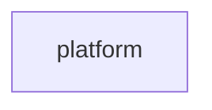

# Context map

## Contexts

### Context: platform
- **Name**: <!-- name in the artifact language -->
- **Type**: generic
- **Responsibility**: <!-- authentication, logging, configuration, common layout, shared helpers -->
- **Owned data**: <!-- tables, files -->
- **Entry points**: <!-- path:symbol, screens, endpoints, jobs -->
- **Evidence**: <!-- why this boundary -->

### Context: <!-- id -->
- **Name**:
- **Type**: <!-- core / supporting / generic -->
- **Responsibility**:
- **Owned data**:
- **Entry points**:
- **Evidence**:

## Relationships
| Upstream | Downstream | Pattern | Channel |
|---|---|---|---|
| <!-- context --> | <!-- context --> | <!-- shared kernel / customer-supplier / conformist / anti-corruption layer / open host --> | <!-- call / table / file / event --> |

## Shared data
| Data | Owner | Also written by | Read by |
|---|---|---|---|
| <!-- table or file --> | <!-- context --> | <!-- contexts --> | <!-- contexts --> |

## Diagram

